# EFF Mod制作流程及插件的约定
## 概览
这是一个插件,旨在帮助用户更快捷方便地加载以及制作明日方舟终末地的mod.插件主要分为解包,blender制作以及插件加载的三个部分.
## 功能
- mod可以使用游戏中任意材质,贴图无需dds压缩选择格式,会自动继承游戏的对应贴图的格式
- 按下**F10**热重载mod
- 通过按键切换显隐mod的部件,按下**INS**选择是否运行某个mod的按键切换
- 可装配形态键,可按键控制形态键
- 可直接指定多LOD都使用LOD0级别网格,无需额外制作LOD
## 制作流程

- 插件下载与安装
  - 下载[dll插件](https://github.com/ssice-a/EFF/releases/tag/v1.3.3),解压并负责里面的内容到游戏路径:如D:\Hypergryph Launcher\games\Endfield Game
    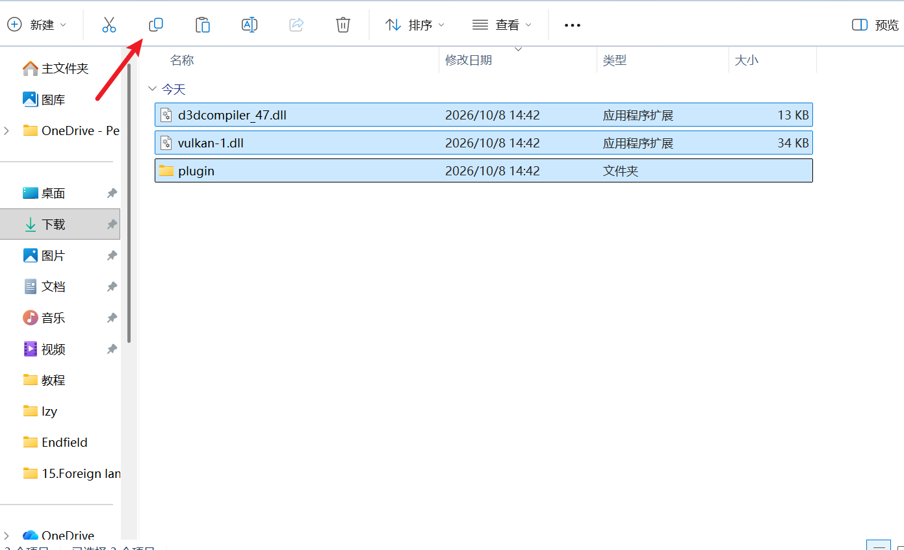
    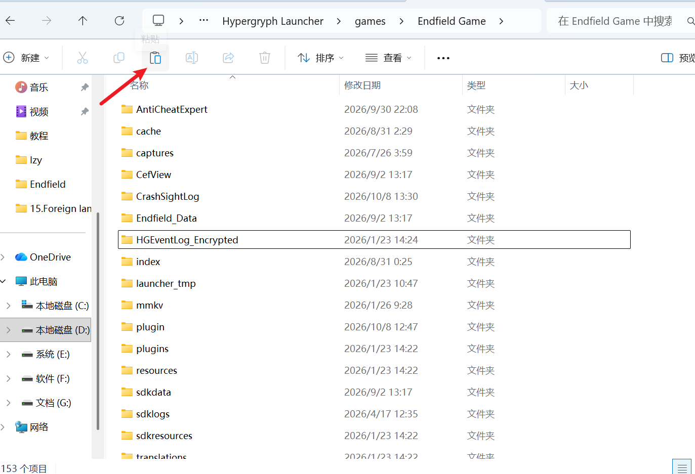
  - 下载[blender插件](https://github.com/ssice-a/EFF-blender/releases/tag/v0.40.2)以及[animestudio](https://github.com/ssice-a/AnimeStudio/releases/tag/v1.3.1)并自行安装

- 解包

    - 打开animestudio,选择open VFS然后选择游戏路径如:D:\Hypergryph Launcher\games\Endfield Game\Endfield_Data\StreamingAssets\VFS
        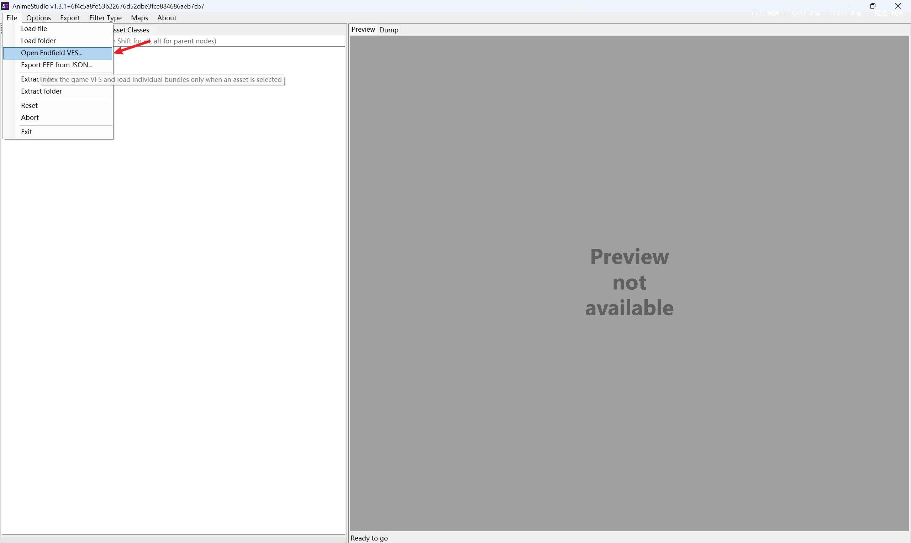
        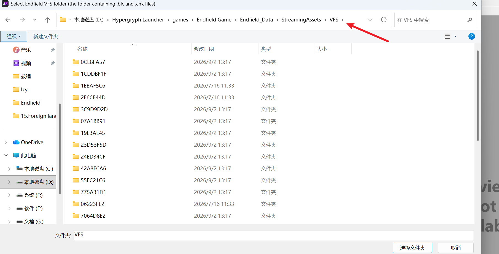
    然后选择选择保存路径,首次解包可能需要较长时间
        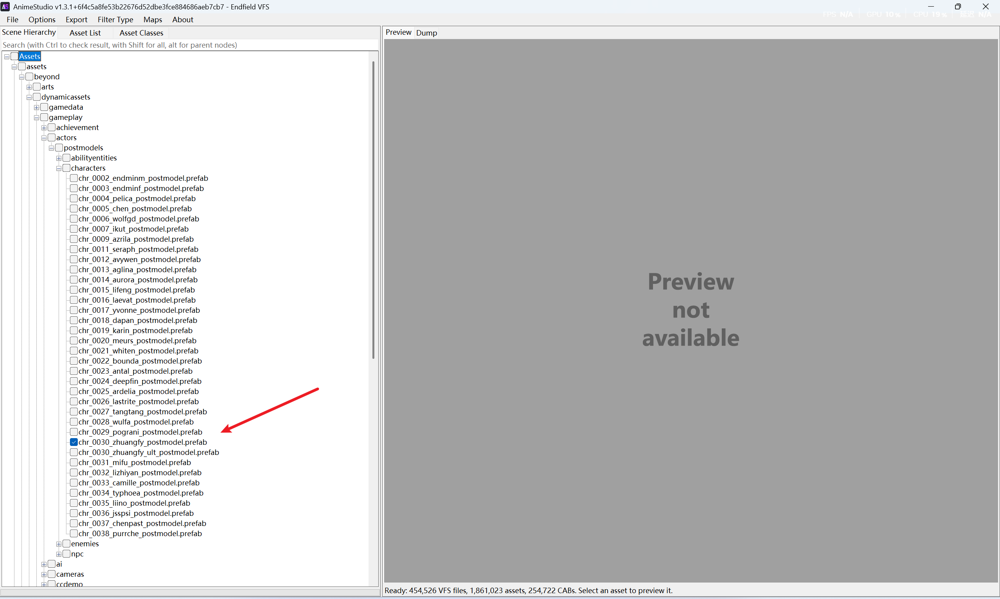
        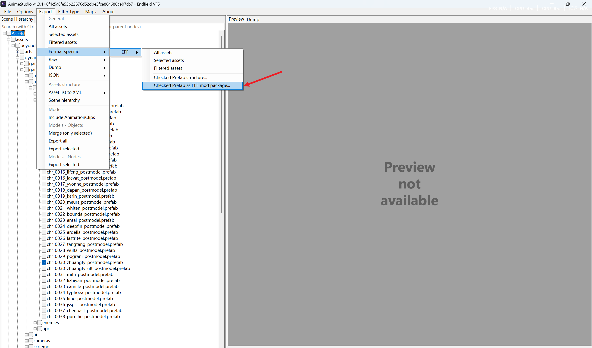

- blender修改

    - 先导入模型
        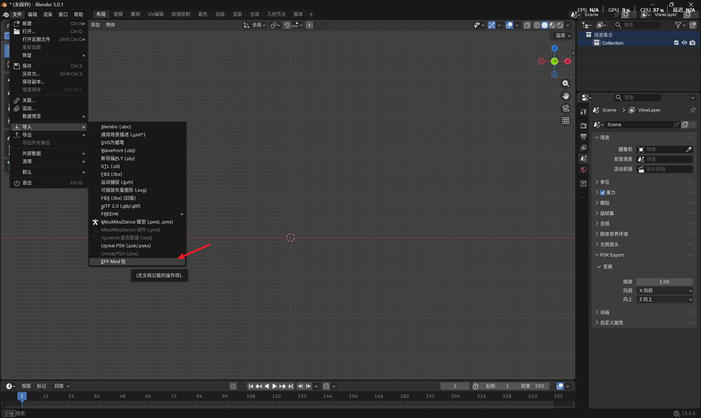
        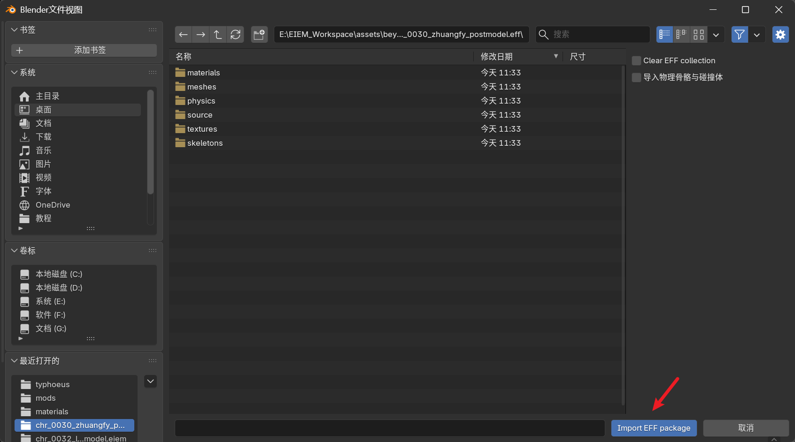
    - blender侧修改模型
        主要有以下规则
    1. 以游戏的数据为准则,所有的数据都写在导入时的mesh内,如果是将外部模型导入替换游戏内模型,请将你的mesh合并到你想替换的mesh上,**如有多个模型都想替换一个模型**,可以多**复制几份导入的模型一一替换,或者替换后分离网格也是可以的**
    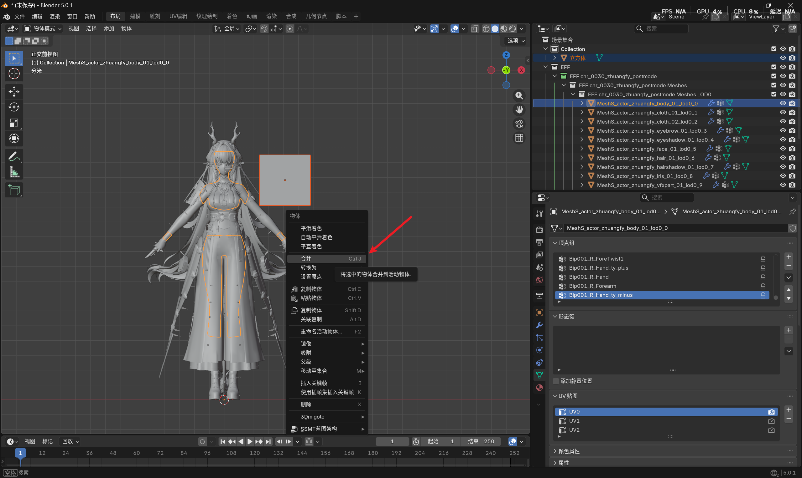
    2. 请检查合并前你的mesh UV是否正确且主要的UV名称为UV0,不要有颜色属性,顶点组的名称是否是EFF内的骨骼名称
    3. 关于材质,游戏内使用的材质取决于该网格内材质属性的EFF材质,你可以在里面修改贴图为你自己磁盘内的贴图路径,可以点击导入EFF材质导入其他角色的材质
    4. **注意,各个网格共享的材质中你修改其中一个材质的内容,其余的网格也同步修改,如需新建材质,请点击新材质**
    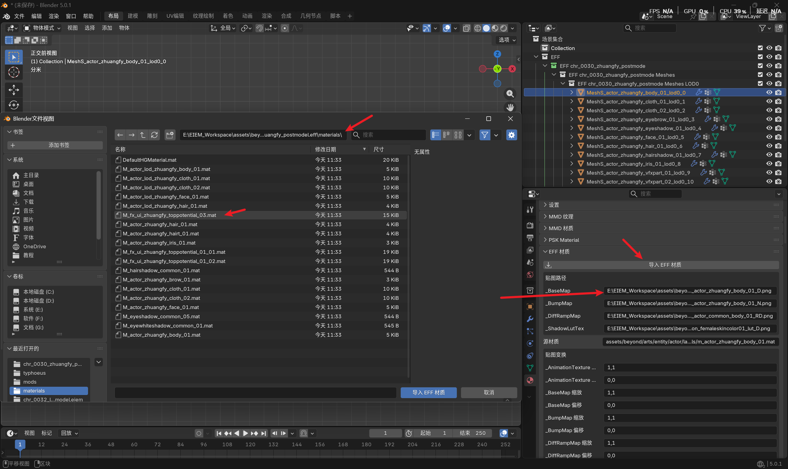

- 导出

   选中你想导出的网格,点击侧边栏导出按钮即可导出,注意相机渲染为隐藏的物体会在游戏内也表现为隐藏.注意导出的文件夹要放在mods文件夹下
   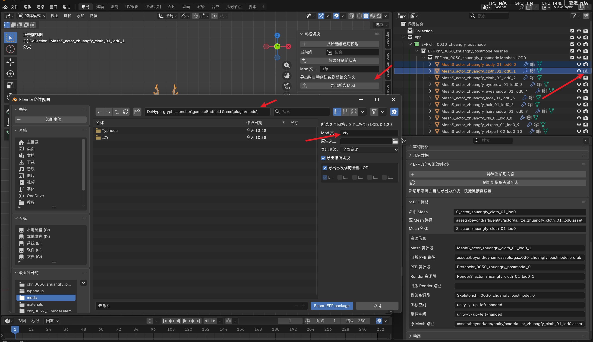
## 注意事项
- 游戏内按ins打开按键切换控制面板
- F10热重载
