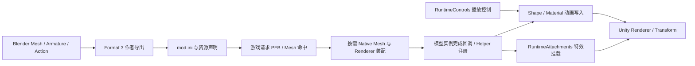
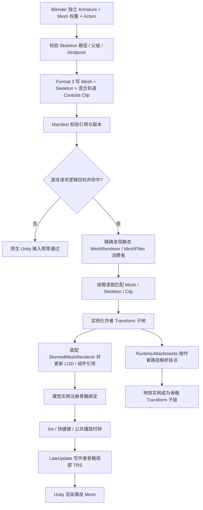

# 骨骼动画装配设计

状态：Blender 统一动画组与 Format 3 混合轨道已接入，2026-11-07。形态键与骨骼轨道使用同一个 Clip ID、时间范围、整数采样率、样本数、循环/自动播放/倍率/按键设置；Skeleton 是独立资源。DLL Catalog 已读取并验证混合轨道及骨架路径；共享播放器现已按 Clip 时钟同时求值 Shape 与 Bone 样本，并覆盖同目标冲突、暂停和停止。Bone TRS 尚未写入实际 Unity Transform，未做游戏内验收。

## 结论

第一阶段应验证一条最小端到端链路：给原本无骨架的武器静态 Mesh 添加两个作者骨骼，替换游戏武器网格；在一个动画组里让同一时间轴同时驱动形态键和骨骼 TRS，再把 EFF 特效挂到其中一根作者骨骼上。播放、暂停、停止和速度属于 Clip，不属于某一种轨道。第一阶段不加物理、不驱动游戏原有骨骼、不做动作混合，也不导入游戏 Animator 状态机。

这不只是增加一种动画文件格式。至少要把作者骨架身份、Mesh 蒙皮数据、静态 Renderer 的原生对象装配、按命中实例绑定、动画时钟和 Transform 写入顺序接成一条事务链。仅将静态 Mesh 的 `MeshRenderer` 改成 `SkinnedMeshRenderer`，或只把曲线采样写进文件，都不足以让游戏正确播放。

## 现有链路

| 链路 | 当前实现 | 对骨骼动画的意义 |
| --- | --- | --- |
| Blender Mesh 导入/导出 | Mesh 可携带紧凑骨骼调色板、bindpose、顶点权重和骨骼路径；Armature 通过完整源路径与父级关系恢复。新增骨骼目前要求挂在已导入的共享骨架内。 | 可复用 Mesh 蒙皮编码的基础，但不具备独立作者骨架的资源身份与运行时 Transform 创建链路。 |
| Blender 统一动画组 | Mesh 的 Shape Key Action 和 Armature 的 Object Action 可加入同一播放组；共用范围、整数采样率、样本数量、按键、循环、倍率和自动播放。预览把两类 Action 映射到同一临时时间轴。驱动器及未烘焙 NLA 不接受。 | 轨道按类型保存：Shape 是标量频道，Bone 是 Skeleton 路径上的局部 TRS；轨道类型独立，Clip 和时钟统一。 |
| Blender `.eanim` | 从游戏资源导入面部骨骼动画并映射到已有 EFF Armature；它不是 Mod 骨骼动画导出格式。 | 不能直接作为自建骨架动画的运行时输入。 |
| Format 3 作者资源 | Manifest 声明独立 Skeleton；Controls 里的一个 Animation Clip 可同时包含 Shape 与 Bone 轨道。`ShapeAnimation<ID>` 只标识该统一 Clip，不存在单独的 `BoneAnimation<ID>` 声明。Python writer 与 C++ Catalog 校验共享时钟、采样率/样本数和 Skeleton 路径。 | 文件资源仍延迟加载；轨道统一不代表把所有网格或骨架预载入内存。 |
| 按需 Mesh 装配 | 命中原生 Renderer 后改写 Mesh 引用；原生 `SkinnedMeshRenderer` 的骨骼路径必须唯一解析到该 PFB 的现有 Transform。静态 `MeshRenderer + MeshFilter` 只接受无骨骼、无形态键网格。 | 现有装配既不会创建新骨骼 Transform，也不会把静态 Renderer 转成蒙皮 Renderer。 |
| 播放控制与运行时写入 | `RuntimeControls` 提供按键和 Ins 操作、共享播放时钟、暂停/停止/循环和倍率；播放器按同一相位输出 Shape 标量与 Bone TRS 样本，Shape 仍写入已注册 Renderer 的 BlendShape 权重 API。Material 动画复用播放控制。 | 还需按实际模型实例解析 Skeleton 路径、保存绑定姿态并将 TRS 写入作者骨骼 Transform。 |
| 特效挂载 | `RuntimeAttachments` 已能将特效父节点挂到 Skinned Renderer 的骨骼 Transform，并处理 LOD、实例可见性、F10 与 owner 释放。挂骨骼时要求 Renderer 是 `SkinnedMeshRenderer`，再用 rootBone、当前骨骼数组、Mod Mesh Palette 和完整层级路径唯一解析挂点；独立挂载则使用来源证明。 | 可以复用特效实例生命周期；Blender 作者导出目前要求挂点属于来源 PFB 骨骼 Palette，静态武器也尚未生成运行时作者骨骼 Transform。需改为验证作者 Skeleton 路径，并在骨架装配后解析挂点。 |
| 模型实例与热重载 | 实际模型完成时注册该实例的 Renderers；Helper 完成时注册已有 Renderer 列表。F10 通过新一代资源/控制图提交后继续注册。 | 骨骼 Transform 和播放绑定必须属于实际模型实例与当前资源代，不能只按 Mod 名称保存 Unity 对象指针。 |
| Physics | Physics 有自己的作者文档、骨架依赖、输入装配和游戏物理组件路径。 | 骨骼动画接通不能推导出新增骨骼已通过物理初始化、碰撞或求解器验收；物理留到后续阶段。 |

## 主要缺口

### 作者骨架身份

`tools/Blender/eiem_blender_addon.py` 负责 Skeleton 节点及局部 TRS；主 Format 3 目录现已声明作者 Skeleton，Mesh 通过稳定 ID 引用它。独立作者根骨骼可以作为骨架根，不必先有游戏来源根节点。骨骼身份使用完整层级路径，Mesh 保留各自紧凑调色板和 bindpose。

Skeleton 是独立、稳定的资源。节点使用 Mod 内路径、父节点索引和局部绑定姿态；来源节点与作者节点需可区分。骨骼名只用于显示，绑定身份使用完整路径。Mesh 的紧凑权重调色板继续保存路径/哈希与 bindpose，并明确引用该 Skeleton，不能假定所有 Renderer 共用同一调色板或用节点序号代替路径身份。

### 静态 Renderer 到蒙皮 Renderer

`RendererMemberBuilder` 当前分开处理原生静态和蒙皮消费者。静态分支沿 `MeshFilter` 改 Mesh 引用；蒙皮分支沿 `SkinnedMeshRenderer` 写 `m_Mesh`、`m_Bones`、`m_RootBone`、BlendShape 权重及 bounds。静态分支明确拒绝非空骨骼或形态频道。

新的静态网格需要成为 Unity 的蒙皮 Mesh，并有真实的实例 Transform 调色板。运行时装配要在命中的 PFB 中为作者骨架建立 Transform 层级、将蒙皮 Renderer 绑定到这些 Transform，并正确更新 GameObject 组件清单、LODGroup、自定义 Renderer 列表和依赖预加载。原静态 Renderer 不能与新 Renderer 同时绘制；替换或禁用行为必须纳入同一对象改写事务。每个实际消费者都要生成自己的 Transform 实例，但可共用不可变 Mesh、Skeleton 与动画字节。

### 骨骼轨道与 Transform 写入

统一 Clip 的 Shape 轨道是变量名到 float 样本；Bone 轨道按 Skeleton 路径定位节点，保存位置、归一化旋转和缩放样本。Format 3 与 Catalog 已将它们放在同一 Clip 并校验同一时间轴。运行时仍需明确绑定姿态恢复与局部 TRS 写入语义；首片只让作者轨道驱动作者新增骨骼。

Transform 同时可能被游戏 Animator、EFF 动画和物理写入。第一片段应只允许轨道指向作者新增骨骼，不触碰原生动画骨骼；必须在目标 Unity 更新时序中验证游戏 Animator 已更新后、物理未覆盖之前写入。仅知道当前 Hook 位于 `TailGameLoop.LateUpdate` 不足以证明这个顺序，需实机观察并用可重复用例确认。若无法保证顺序，应增加明确的玩家循环阶段 Hook，而不是每帧扫描场景或反复创建对象。

### 特效挂到作者骨骼

现有特效挂载不是从任意字符串直接查场景对象。Blender 先从来源 Prefab、Renderer、Mesh 和原生骨骼调色板生成证明；运行时再在匹配的实际模型实例中找到对应 Renderer。对于角色 Mod Part，运行时按该 Mod Mesh 的骨骼 Palette 与实际层级路径唯一解析挂点；独立挂载则校验来源证明。原生骨骼挂载已有实例生命周期，可以延伸到作者骨骼，但必须让它看到装配后的作者 Transform 树和作者 Mesh Palette。

作者特效资源应保存 `skeletonId + bonePath`，而不是把显示名或 Blender 骨骼序号当成挂点身份。Format 3 校验要求该路径存在于目标 Mesh 声明的作者 Skeleton；运行时要求 Mesh Palette、作者 Skeleton 与实际创建出的 Transform 树一致。附件绑定必须在骨骼树创建完成后执行，卸载或 F10 换代时再由现有 owner 生命周期释放/重绑。这样特效才能跟随骨骼动画的局部姿态，而不会依赖 Blender 预览位置或武器源 Prefab 中不存在的节点。

### 资源加载与实例生命周期

资源仍遵循命中后替换：启动时只读 Manifest 和播放元数据，不把所有网格、动画或运行时 Unity 对象预先创建进内存。只有实际请求命中目标且准备装配匹配的静态 Renderer 后，才读取它声明的 Skeleton/Clip；不可变数据可在同一资源代内共享缓存。每个匹配消费者有自己的骨架 Transform 和绑定记录，Mod 播放时钟按现有控制组共享，同一 Mod 的多个已加载实例采样同一相位。

F10 必须把新代的 Mesh、Skeleton、Clip 与控制声明作为一组校验并提交。绑定记录要持有代际和实例根身份；旧代对象只在原生消费者释放或实例生命周期结束后退休。热重载不能把旧骨骼对象指针带入新资源代，也不能在更新失败时发布缺少骨架或片段的半成品。

## 建议的最小数据契约

首版由独立 Skeleton 资源和 Controls 中的统一 Animation Clip 构成；特效附件声明增加作者 Skeleton 路径身份：

- `Skeleton`：稳定 ID、坐标约定、节点路径、父索引、绑定局部位置/旋转/缩放、来源标记。至少一个根节点，禁止重复路径、循环父级、非有限数和不可表达的剪切。
- `Animation Clip`：一个稳定 ID 对应一套播放设置和时间轴。Shape 标量频道与 Bone TRS 轨道可以并存；Bone 轨道包含 Skeleton ID、节点路径和样本。统一的时间范围、整数采样率、样本数、循环、自动播放、倍率和按键只存一份，不生成独立 BoneAnimation 声明。
- `Mesh`：记录 Skeleton ID 和自己的紧凑骨骼调色板；每个顶点骨骼索引都在该 Palette 范围内，每个 Palette 项都能解析到 Skeleton 路径，bindpose 数量与 Palette 一致。
- `Controls`：保存 Clip 的播放状态、Shape 样本轨道、Bone TRS 样本轨道及轨道目标身份。轨道样本随 Controls 作者资源延迟读取；播放时钟、暂停/停止、倍率、循环、自动播放和快捷键按 Clip 共享。每种轨道仍保留自己的数据类型与写入目标。
- `EffectAttachment`：挂作者骨骼时保存 `skeletonId + bonePath`，并验证目标 Mesh Part 确实引用该 Skeleton；挂原生游戏骨骼仍沿用原生骨架路径证明。运行时的父 Transform 必须来自同一模型实例中的已装配骨架。

采样规则：同一 Clip 的 Shape 与 Bone Action 使用同一个范围、整数采样率和样本位置；导出为有限数值样本。运行时用位置/缩放线性插值、旋转归一化球面插值；循环在首尾区间规则固定，停止时回到绑定姿态。第一片暂不保留任意插值器、驱动器、NLA 混合、骨骼缩放以外的矩阵/shear，也不做运行时 Blender 曲线重建。Blender 预览和作者包采样已按共享采样数实现，游戏内 Transform 写入与播放尚待实现和验收。

播放策略首版采用一个控制组一条活动骨骼片段，冲突时停止旧片段；不做过渡、混合树或多片段叠加。播放状态只保存时间与控制状态，不复制 Mesh 或每帧重建 Skeleton。所有实例共享不可变 clip 和控制组相位，各自接收自己的 Transform 写入。

## 端到端调用图

## 垂直切片与验收

1. Blender 在原本无骨架的武器 Mesh 上新建两骨骼作者 Skeleton，Mesh 具有明确的两骨骼权重和 bindpose；导出后往返导入，路径、父级、姿态、权重调色板保持一致。
2. 单个 Format 3 Mod 精确命中一个原生静态 MeshRenderer。只在此命中后加载对应作者资源，创建两个实例 Transform，装配 SkinnedMeshRenderer，并正确替换原静态消费者。
3. 一个 Action 轨道驱动两个作者骨骼，循环时武器网格可观察地形变；快捷键和 Ins 控制能播放、暂停/继续、停止归位及调速。
4. 将一个现有 EFF 特效挂到作者骨骼 `Tip`；验证预览与导出保存的是同一骨骼路径，游戏内特效随骨骼动画移动，武器隐藏/显示和 LOD 切换继续遵循挂载 Renderer 状态。
5. 同一 PFB 建立两个实际武器模型实例时，两者都有独立 Transform 树，且都能按同一播放相位运行；销毁/切换一个实例不会释放另一个实例仍在使用的骨骼或特效。
6. F10 后验证修改后的 Mesh 权重、绑定姿态、动画和特效挂点同时生效；删除或损坏 Clip/Skeleton 时保留已提交代并报告具体资源身份，不发布部分状态。
7. 以静态原版、静态 Mod、动画武器 Mod 做 A/B；记录绑定骨骼数、Renderer 类别、命中数、实例数、资源读取次数及每帧写入数。检查大世界、武器展示/UI、LOD、切场景、实例卸载与重新加载。

首阶段明确不验物理、不允许动画写入游戏已有骨骼、不支持 Animator 状态机/任意游戏 ACL、约束与多轨混合。完成武器垂直切片后再单独验收 Shape Key 共用时间轴、角色 UI/大世界多消费者和物理更新顺序。

## 阻塞清单

- **格式阻塞：** 已完成 Skeleton Manifest、混合轨道 Controls 和 Catalog 的路径/采样一致性验证；仍需对完整游戏 Mod 进行装配验收。
- **Blender 阻塞：** 统一动画组、骨架根、采样与 Format 3 导出已接入；现有 Blender 环境没有可用命令行进程，本轮新增的实时 Blender 回归脚本尚未执行。
- **装配阻塞：** 静态 MeshRenderer 消费者不能接收有骨骼的 Mesh，装配器也不会生成运行时作者骨骼 Transform 或 SkinnedMeshRenderer。
- **播放阻塞：** C++ Catalog 已读取混合 Bone 轨道，但 Runtime Player 尚未按骨骼路径采样、按模型实例写 Transform，亦未接 Ins 面板中骨骼片段的播放状态。
- **特效挂点阻塞：** 当前 Blender 导出要求挂点骨骼属于来源 PFB Palette，静态武器也没有运行时作者 Transform；作者新增骨骼尚未进入可验证的 EffectAttachment 身份链。需要关联作者 Skeleton 路径，并保证挂载在新骨架实例化后解析。
- **时序阻塞：** 需验证 EFF 骨骼写入与 Animator、LateUpdate、物理求解的相对顺序；尚无游戏内动画验收。
- **生命周期阻塞：** 需把 Skeleton/Clip 资源、每消费者 Transform 和 F10 代际退休纳入同一提交/回收模型，并验证 UI、大世界、多个实例和 LOD。

## 调研依据

- [Format 3 Manifest 类型](../src/eiem_runtime_author_manifest.h) 与 [按需作者目录](../src/eiem_demand_author_resources.h)
- [原生 Renderer 装配与静态 Mesh 限制](../src/eiem_renderer_input_builder.h)
- [运行时播放控制](../src/eiem_entry_controls.h)、[Shape 播放器](../src/eiem_shape_animation_player.h) 与 [LateUpdate Shape 写入](../src/eiem_entry_runtime_shapes.h)
- [运行时特效骨骼挂载](../src/eiem_entry_effect_attachments.h)、[Blender 特效挂点证明](../tools/Blender/eiem_effect_editor.py) 与 [特效作者操作](../tools/Blender/docs/effects-editor.md)
- [Blender Skeleton 编码与权重导出](../tools/Blender/eiem_blender_addon.py)、[`.eanim` 面部动画导入器](../tools/Blender/eiem_animation.py)
- [现有 Shape 动画契约](shape-animation-design.md) 与 [Physics 作者契约](physics-authoring-design.md)

