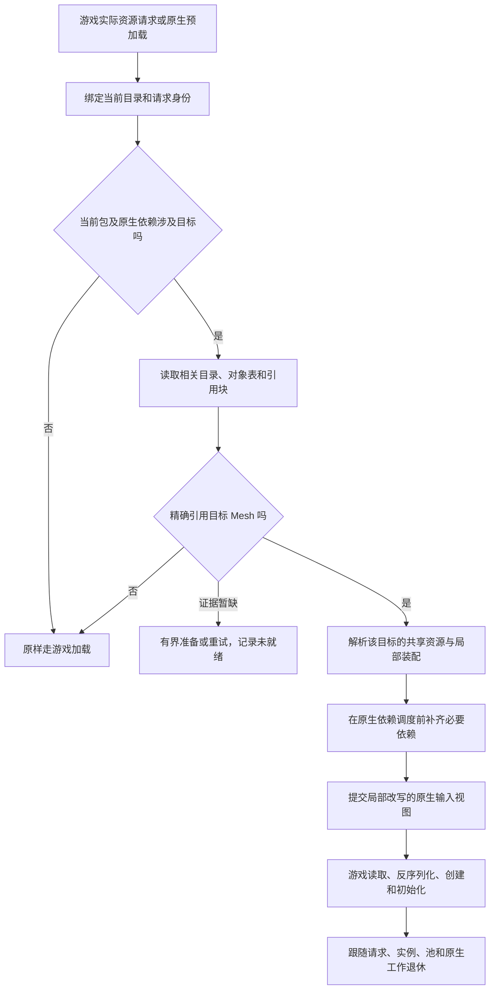

# 跟随游戏加载的 Mesh 命中与共享原生资源设计

状态：开发中，2026-10-29。06:52 PID1788 验收失败：跨角色材质的游戏贴图依赖缺失、共享输入错误包含消费者分类导致键冲突，出现部分网格替换而消费者骨架仍原版的撕裂。07:05 已配对部署修复版开发 DLL 与逻辑依赖新目录，SHA-256 `4FE54C33C8CD35E2154D05B76D4119B8FC84D36EEB3EA8128E49F2CB23B903EA`。逐项资源审计及共享冲突、原生引用搬迁、骨架完整路径本地回归通过；新游戏画面与共享依赖交付尚待实机重测，F10 仍关闭，全功能未验收。以下各时点部署与单身体记录为历史；最新部署详情见文末。

## 2026-10-30 已确认的资源与交付契约

用户已同意 [ADR-0001](adr/0001-authoritative-mod-directory.md)。Mod 是可自由组织文件的目录，不要求封成单一归档；`mod.ini` 是唯一持久化的资源关系与规则清单，资源 ID 可映射到用户选择的相对路径并可复用。运行时索引从清单临时建立，不能要求用户另行维护二进制索引才能让 Mod 有效。

贴图是标准 DDS 文件，磁盘字节不加 EFF 私有头、尾或外层容器。Blender 在 mip 生成和压缩前按来源 Texture 与材质绑定语义选择默认设置；外部 DDS 根据资源/材质语义绑定，不能仅因 DDS 的色彩标志不同而拒绝。DDS 头保留原样，纹理的游戏语义由声明和绑定决定。运行时不重新压缩贴图，也不扫描、解压或改写整个资源包。

Blender 导出的 Mesh、材质、贴图、物理和特效必须保留插件可读回的作者语义。DLL 的 PFB 消费者发现留在真实游戏加载链路；运行时只处理当前请求命中的局部序列化对象。外部替换 DDS 后 F10 只刷新变化贴图及受影响的已加载 owner。各端均须分阶段记录时间与处理字节；运行时内存、显存和资源退休分别验证。

实现顺序固定为：DLL 需求加载/DDS/F10/生命周期与计时；Blender 新目录导出、标准 DDS 和分资源回读；Mod Manager 一键迁移旧格式并原子保留回退副本。当前各端状态与验收边界见 ADR；本文下方记录作为历史实现证据，不代表完成条件已通过。

本文是本轮开发的主设计。已有生产实现、历史性能数据与试验结果分别保留；涉及本轮实施方向时以本文为准。[上轮试验证据](mesh-target-runtime-test.md)中的加载后匹配用于证明筛选可能性，手工创建 Mesh 的失败试验不再推进。

## 1. 已确认的目标与决定

1. 将 **PFB 消费者发现与命中从离线解析中剥离**。作者包描述要替换的 Mesh 逻辑身份和作者内容，不固定全游戏消费者清单。游戏更新后新增的世界、UI、NPC、剧情 PFB，只要仍引用目标 Mesh，就应在实际加载时命中。
2. 跟随游戏的请求、依赖、预加载、反序列化、创建和退出流程。只在当前请求实际命中目标 Mesh 或需要该 Mesh 的消费者时启用对应替换；Bundle 候选命中不等于允许加载整个 Mod。
3. 同一 Mod 的同一份不可变资源在多个 PFB、多个实例之间共享，不能为每个消费者重新创建一套 Mesh、Texture 或相同语义的材质。
4. 同时优化启动、首次命中、重复加载、F10、CPU 内存、GPU 内存与上传，以及 Blender 冷导出和日常增量导出。不得把启动等待搬成进场卡顿，也不得以整包内存驻留换取表面上的加载速度。
5. 网格、骨骼、材质、贴图、形态与动画、按键控制、特效、物理及碰撞等现有完整功能都在迁移范围内。单角色单部件演示通过不代表完成。
6. 允许修改 Mod 格式、作者资源编码、编译器和四端职责，不保留旧架构作为性能设计的前提。保留原生 metadata、准确来源身份与游戏生命周期的正确性要求。
7. **旧 Mod 由 EFF Mod Manager 一次性转换，新 DLL 只读取新格式。** 不让新运行链长期携带旧全量准备后端。游戏内容更新与 EFF 文件格式升级是两件事，不能混为一个失效条件。
8. 玩家运行只需要 DLL 和转换完成或作者直接发布的新 Mod；不要求 Blender、AnimeStudio、作者索引或编译器在游戏内运行。
9. 作者端必须在离线导出时生成压缩 DDS/BCn mip 数据；DLL 不解码源图、不生成 mip、不压缩。`m_ColorSpace` 继承源 Texture2D 的元数据，不读取 Blender 图片的颜色空间设置。

### 核心原则：跟随游戏按需加载

为控制 CPU 内存、GPU 内存和显存占用，EFF 必须模仿游戏自身的资源加载模式：游戏不会一次性把全部资源载入内存或显存，Mod 也不得这样做。当游戏为某个 PFB 请求或预加载其资源文件及依赖时，EFF 只在对应的游戏加载流程中准备本次确实命中的作者资源；不得在启动时或首次命中时一次性加载全部 Mod 资源。共享的不可变资源按内容身份复用，不因 PFB、Renderer、LOD 或角色实例重复加载；只有游戏实际使用到的资源才进入相应原生加载与 GPU 上传流程。

当游戏实际加载到引用目标 Mesh 的 PFB 时，EFF 必须在游戏原生反序列化/创建该 PFB 之前，局部改写这个命中 PFB 中对应 Renderer 的 Mesh、材质及其他已声明功能引用，并让其依赖的作者资源通过游戏原生资源生命周期就绪；未命中目标的 PFB 和资源保持原样。也就是说，作者资源准备要跟随游戏加载 PFB 资源及其依赖的时机，随后把命中 PFB 的修改交回游戏自身完成反序列化和对象创建，而不是先全量准备 Mod、再另行创建对象或在创建后补救。

资源所有权和释放时机也必须跟随游戏：切换地图、切换编队、关闭人物预览或销毁/回收角色实例时，若游戏释放了对应 Bundle、对象、GPU 资源或工作任务，EFF 必须在相同生命周期边界解除对应引用和租约。按内容共享只允许复用仍被请求、实例、池或原生任务持有的资源；不能因为进程级缓存、manifest 仍存活或曾经命中过，就让已无消费者的作者载荷、Unity 对象或显存资源长期驻留。可重建的 CPU 缓存可以有界保留，但必须与游戏对象租约分开计量，并能在代际退休或内存压力下回收。

上述顺序是必须实现的目标，不预设具体游戏回调或加载接口。实现必须找到可在游戏提交相关资源请求时按命中登记作者依赖、并在 PFB 反序列化前提交改写的真实生命周期边界；如果当前观察到的入口无法保证这个时序，应继续定位正确边界，不能用全量预载代替按需加载，也不能把尚未验证的依赖登记视为已接通。

## 2. 已知事实与尚未证明的边界

### 2.1 已有证据

- 游戏存在 `RuntimeManifestBinary`，可按目标逻辑路径及 FBX 子资源名查询当前 Bundle key 和 asset key；不需要为此展开所有 PFB。
- `BundleProxy` 生命周期和 `TryGetBundleDeps` / `TryGetBundleDirectDeps` 提供实际包请求与正向依赖的观察位置。
- VFS / 原生装载接口存在文件路径、偏移及同步/异步形式。物理大文件、其中的 Bundle、Bundle 内的 PFB/资源对象不是同一层。
- 已解析的 Endfield 包含成员目录和压缩块目录，支持定位到块；这证明格式可定位，不等于已经测清游戏的预读、解压缓存和资源驻留策略。
- 现有生产输入替换在游戏反序列化之前提交合法原生数据。序列化写入器保留未改对象载荷、原 external 记录、类型、脚本和相关元数据；这是保真的可复用基础。
- `EndfieldInput::Decode` 当前会解压并拼接所选 Bundle 的所有数据块，`ReadSource` 会完整读取指定输入范围并计算摘要。两者不能直接放进首次命中的同步请求中作为新方案。
- 已有分段输入视图和 stream 生命周期管理，可引用原游戏字节和作者字节；它们不能单独证明新方案已实现按对象读取或已降低 GPU 驻留。

### 2.2 实机数据的使用限制

之前一次加载后探针中，194 个目标对应 57 个 Bundle；单个目录对象解析约 0.7～0.8 ms。941 次来源检查有 930 次直接排除，11 次进入局部检查。它证明目录筛选在这次样本中有效，**不证明创建前字节检查、全部加载入口、原生替换或完整功能的性能**。

上轮手工 `new Mesh` 路线因属性创建失败，没有完成替换；同时确认骨骼哈希、骨骼包围盒和特殊 UV 标志的保真缺口。不能补几个 setter 后将其当作本设计的替代。

### 2.3 必须优先证明

1. 实际资源请求与 Bundle、当前 VFS 位置、原生输入流之间的准确关联，包括跨线程异步交付；不能只依赖线程局部字符串或事后 `AssetProxy.Get`。
2. 当前目录的 asset key 如何在创建前映射到准确 CAB / PathID；asset key 不能直接当成 PathID。
3. 新增依赖能否在游戏调度该次依赖之前登记，且仍由游戏加载、持有和释放。
4. Bundle 已因无关资源打开，目标 Mesh 稍后才被请求时，仍能在目标对象反序列化前提供修改输入。
5. 新格式能否让不同 PFB 引用同一个作者原生资源对象，而不只是共享磁盘文件或 CPU 字节。
6. 实际输入格式下，局部改写能保留哪些原压缩块；输入流回调、随机读取、块解压、目录修订各有多少额外成本。

缺少这些证据时保持“待验证”，不得用加载后修补、主动加载全部目标、扩大预加载或重新离线枚举全部 PFB 掩盖问题。

## 3. 身份、资源与实例的划分

### 3.1 长期身份

- 规则目标：规范化的游戏逻辑路径、子资源身份及明确声明的 LOD 身份。材质/Shader 来源决定依赖，不扩大 Mesh 命中范围。
- 作者资源：Mod 稳定 ID、资源稳定 ID、内容版本与必要的原生语义变体。改名、文件搬移和 Blender 显示名不能成为唯一资源身份。
- 当前读取地址：目录代际、Bundle key、物理文件/范围、CAB、PathID、当前布局。它们属于本次游戏安装的定位结果，可以失效后重新查询。
- 运行时对象指针：只用于同一代游戏中验证多个已加载引用是否共享一个 Unity 对象；不得用来命中 Mesh、识别 Mod 目标或判断游戏更新后的兼容性。
- 缓存证明：来源局部状态、布局与作者内容摘要。证明过期只使缓存失效，不能使仍存在的 Mesh 逻辑身份失效。

游戏只修改 Mesh 顶点、贴图像素、CAB/PathID 或物理文件位置时，按逻辑路径和子资源名从当前目录重新定位或重算相关局部数据；不重新反查全游戏，也不因旧 CAB/PathID 或旧内容指纹不同就让 Mod 失效。游戏字段/布局变化时按当前结构适配必要字段并保留未声明字段；确实缺失逻辑目标或必要语义不可适配时报告具体目标与操作。

### 3.2 一份资源与多个实例

| 可以共享的不可变内容 | 必须按实际实例独立的状态 |
| --- | --- |
| Mesh 几何、bindpose、形态数据 | 当前骨架 Transform、动画姿态与形态权重 |
| Texture 原生对象及像素/mip 数据 | 游戏要求的实例材质参数、PropertyBlock、显隐 |
| 相同语义的 Material/Shader 引用 | 材质控制器的可变副本与动态材质轨道状态 |
| 特效模板、图集、粒子 Mesh 与材质 | 粒子存活、发射、随机种子、拖尾与模拟缓冲 |
| 物理配置、链描述、碰撞体定义 | 每个角色的物理求解、碰撞体 Transform、原生 Job |

共享键不能包含来源 PFB 路径或实例 ID。同一 PFB 重复创建、世界/UI/NPC 同时显示，不能因此复制大资源。游戏确需不同 Shader、采样或布局语义时，生成明确且去重的最小变体；几何和像素仍尽可能共享。不能为了追求“一份资源”让不同角色共享骨架、物理或粒子运行状态。

## 4. 目标加载流程

图中是职责顺序，不要求游戏原有的并行请求串行化。实现必须在游戏真实调度时序中找到对应边界，不能在最终读取回调里同步等待同一资源管理器队列。

### 4.1 启动

只发现 Mod、读取小型声明/目录并建立目标索引。允许在游戏目录可用时查询已声明目标。不读取所有载荷，不验证全部资源大文件摘要，不恢复所有旧消费者图，不准备所有输入视图，不创建作者 Unity 对象，不上传 GPU。

### 4.2 请求观察与候选筛选

按实际请求记录资源身份、Bundle 身份、依赖、实际输入范围、同步/异步状态和资源代际。请求、Bundle 完成、Asset 完成、实例创建、卸载分别记录，不能相互代替。

候选筛选复用游戏已经给出的依赖，包含 Bundle 自身。使用目标 Bundle 索引，不对每个请求遍历所有 Mod、不重新查询完整依赖图、不枚举全部 Bundle 名表。无关请求不读取作者载荷、不遍历场景、不展开包内容。

候选依赖过宽时必须记录候选率和额外读取量；不得假设所有游戏打包方式下都只有少量候选。未就绪与确定未命中分开，负缓存随目录/规则代际失效。

### 4.3 创建前精确匹配

从当前相关输入的资产目录得到对象身份，只检查相关 Renderer / MeshFilter 的 Mesh 引用；按对象类型跳过无关对象，不解码全部 Mesh 数据来判断身份。同名不同来源、FBX 子资源、静态与蒙皮 Mesh、同包/跨包引用分别验证。

匹配对象以当前真实引用为准，旧 PFB 清单只允许作为开发对照，不能成为白名单。新剧情 PFB 不在作者旧清单中仍须生效。目标 Mesh 内容变化不会改变此匹配原则。

### 4.4 命中后的资源与结构处理

- 同一资源的并发准备合并为一次任务，结果由多个请求共享。
- 作者端已完成的顶点处理、法线切线编码、mip 生成、图片解码和压缩不在 DLL 重做。
- 单一几何替换且 Renderer 配置仍适用时，只修改资源输入；0/1/N 部件、骨骼槽、材质绑定、物理、特效与 LOD/helper 关系变化时，局部修改实际命中 PFB 的必要结构。
- 多个 Mod 只在实际写入同一输入时组合；不同输入之间不做笛卡尔组合或准备全局消费者结果。不同 Mod 声明相同 Mesh 目标时按 Mod ID 排序组合各自 Part；同一对象的冲突字段由排序靠后的 Mod 决定。此规则不扩展到同一输入中的无关对象。同一 Mod 内重复声明同一目标仍然是格式错误。
- 未修改对象保持原载荷。类型、脚本、external、preload、对象表与大小/偏移按实际修改修订，保持引用闭包和原生格式合法。
- 相同作者资源不嵌入每个 PFB。消费者只增加必要引用或实例组件；大资源有唯一共享归属。

### 4.5 已打开包与延迟对象读取

“只在命中时加载”不能导致错过创建前替换：一个包可能先为无关资源装载，目标对象稍后才被读取。

优先验证在创建前输入视图中描述必要的对象路由/元数据、延迟作者载荷读取的方式。准备小型元数据不等于创建原生资源；单凭同包或依赖相交，不能触发整份作者几何/贴图读取和 GPU 上传。若原生加载器会立即读取载荷，必须取得真实读取证据并调整接入边界或资源布局，不能默认其按对象完全懒加载。

新原生资源的归属、必要依赖和对象身份必须在对应反序列化前确定。不能先让原 Mesh 创建，再通过 public setter、私有布局复制或克隆补救。

### 4.6 游戏加载与退休

保留游戏的同步/异步请求语义、取消与失败处理。异步准备接入游戏调度，不能包装成“worker 干活、主线程等待”。同步入口单独测量不可避免的首次成本。

原生输入 backing 保留到游戏不再读取；实例、池、延迟销毁、捕获和物理 Job 分别解除引用。`Unload(false)`、托管弱引用消失或 Bundle 对象退休都不单独证明 CPU/GPU 资源安全释放。

地图、编队、人物预览和场景切换都必须覆盖在生命周期验收中。验证游戏发出的 Bundle/Asset 卸载、实例销毁、对象池回收及异步任务完成/取消，再核对 EFF 对应租约是否归零、作者输入 backing 是否可回收、Unity 对象与 GPU 资源是否由游戏正常释放。重复切换同一地图和编队时，CPU 工作集、显存和仍存活的引用数应回到稳定范围；仅凭 `ClearAll` 被调用或 Bundle 指针变空，不能判定整条资源链已退休。

游戏原生预加载目标时允许同等提前准备；EFF 默认不添加预测性全角色预加载或逐帧发现。资源管理器按需要重载时复用同一规则。

## 5. 随机读取与内存约束

1. 来源访问抽象必须支持 `ReadAt(offset, size)`，先读取头、块目录和相关元数据范围。不得为读取头部先构造整个 Bundle 的 `Bytes`。
2. 相关对象跨压缩块时读取必要的完整块。块解压使用有界窗口和复用缓冲；不展开所有成员。目录/TypeTree 也计入真实内存和解析成本，不能称其永远很小。
3. 局部修改发生长度变化时重写必要目录和对象偏移；未受影响的压缩块尽量直接引用。确实因编码边界必须重做的块计量并单独优化。
4. 输入视图以原文件区间、作者不可变数据和小型补丁组成。虚拟长度不等于常驻内存；不得为计算整份视图摘要而把所有区间读一遍。
5. 避免原包、完整解压包、修改副本、托管数组和新旧代际同时常驻。优先使用可随机读取的文件/流，实测 stream 回调开销与游戏预读，不能仅凭“零拷贝”名称判定最快。
6. 分别限制解压窗口、正在准备的字节、并发原生请求、缓存和退休代际。限制针对工作集与并发，不给用户 Mod 数量或单资源尺寸设置任意静默截断。
7. 磁盘大小、映射地址空间、进程私有提交、工作集、GPU 本地/共享内存分别统计。不能把“10 GiB Mod 未全部读入”解释成“任何场景都不会内存不足”。全部实例真正使用的资源仍有实际驻留成本。
8. 卸载时回收无租约缓存。内存紧张先回收可重建缓存、减少准备并发；仍不可满足时明确失败并保留完整可用版本，不造成部分模型发布或进程崩溃。

## 6. 作者格式与 Blender 导出

新格式遵循 ADR-0001：Mod 目录是交付单元，`mod.ini` 是唯一持久化的关系/规则清单；每个资源是独立、自描述且可由 Blender 导入的文件，用户可按需安排路径。`compiled.bin`、`compiled.blocks` 和独立作者目录属于迁移来源，不是新格式的运行时必需品；不能再以它们作为隐藏的第二套资源真相。

| 内容 | 作者端职责 | DLL 职责 |
| --- | --- | --- |
| 目标规则 | 记录逻辑 Mesh 身份、LOD 与作用范围 | 从当前游戏目录绑定，随实际请求精确命中 |
| Mesh | 几何、索引、权重、形态、通道编码与结构描述 | 适配必要当前字段，提供原生输入，不重算作者几何 |
| 材质/贴图 | 参数、逻辑引用、BCn 像素/mip、源色彩空间与采样 | 解析当前依赖，按原生格式加载并共享 |
| 骨骼/物理/碰撞 | 稳定路径、局部姿态、模板语义、参数与关系 | 映射当前骨架、局部序列化装配、原生生命周期 |
| 特效 | 模块、曲线、渐变、图集、发射器、挂载与依赖 | 准确挂载、原生创建、实例状态与退出 |
| 控制/动画 | 稳定资源/部件绑定、轨道与输入声明 | 现有显隐、材质和形态控制，按实例绑定 |

导出要求：

- 不枚举、展开或编译全部消费者 PFB。即使冷导出，也只处理选中的作者内容和必要来源模板。
- 冷导出没有缓存时仍使用同一局部工作范围；不能只靠命中旧缓存掩盖低效冷路径。
- 新增/删除 Mesh、部件、发射器或物理链只更新相应资源与作者图，不触发全角色 PFB 重建。
- 完整导出与“仅替换资源”共用资源处理管线；后者合并已有作者图、保留未选资源。显式选择与删除语义分开，不能把本次未选中当作删除。
- 导出选择范围保持现有用户契约，不自动扩大到全部可见网格。骨架、物理、挂载和材质依赖按明确规则附带。
- 每资源建立内容和设置依赖，未变原生字节直接复用；图片编码只因相关像素/编码设置变化失效。
- 发布为不可变快照，完成校验后原子切换小型入口。游戏打开旧快照期间仍能导出新版本；旧文件不得长期独占锁定，运行中替换/删除必须纳入验收。
- 结构编码、范围校验、源码协议与 fixture 由 EFF 主仓库统一管理；四端不得各自维护互不兼容的格式副本。

### 6.1 离线贴图压缩

DDS 是标准文件格式，BC7、BC5 等是其中描述的 GPU 块压缩编码。EFF 在 Mod 中保存用户和外部工具都可读写的标准 DDS；不从它剥头后改存 `.tex`，也不在文件头尾添加 EFF 数据。游戏输入需要的原生 Texture2D 视图由加载适配器提供，不改写磁盘上的 DDS。

Blender 导出时离线压缩并直接发布标准 DDS。压缩格式及 mip 生成设置在调用编码器之前，由来源贴图属性和材质绑定语义决定；外部替换 DDS 时保留原文件的标准头，运行时按绑定语义使用像素数据，不因 DDS 色彩标记与 Blender 默认值不同就拒绝。DLL 仅解析 DDS 格式/尺寸/mip 布局并读取对应 mip 数据，不解码源图片、不生成 mip、不压缩，也不更改原 DDS 文件。

BC7 用于通用 RGBA 贴图，来源为 BC5 的法线贴图继续使用 BC5。Blender 默认采用来源 Texture 与材质槽的语义，再选择编码格式及对应 DDS DXGI 变体；图片颜色管理设置不能无意中覆盖作者绑定语义。外部 DDS 按其标准像素块格式解码，并按 Mod 声明的资源用途绑定；即使头部 sRGB 标记不同也不作为拒绝条件。作者侧按像素、目标格式和 mip 设置缓存编码结果；首次压缩与增量缓存命中分别计时，画质单独验收。

## 7. 全功能迁移清单

| 功能 | 完成条件 |
| --- | --- |
| Mesh / Renderer | 静态与蒙皮；0/1/N；顶点/索引/拓扑；压缩法线切线与特殊 UV 标志；bounds；同名不同来源不误命中 |
| LOD | 声明的源 LOD 映射、所有实际消费者、LOD/helper/shadow 引用；作者 LOD0 覆盖低 LOD 不破坏实例骨骼 |
| 骨骼 | 正确的有序 palette、bindpose、权重、root；新增骨骼的父级与局部 TRS；各实例独立绑定 |
| 新增物理骨骼 | 明确不存在原动画轨道，不以缺少动画基准为拒绝或僵硬化理由；走已有原生物理组件与求解流程 |
| 材质/贴图 | Shader/材质逻辑依赖、槽位、alpha、色彩空间、mip、采样和材质变体；世界/UI/NPC 不串状态 |
| 控制/动画 | 多键同组/同目标、组名、显隐、材质切换、形态与材质轨道、暂停/恢复和持久状态 |
| 特效 | 人物附加与独立包、多发射器、billboard/序列帧、已有曲线/渐变/运动模块、挂点、显隐与全 LOD；现有原生碰撞适配不退化 |
| 物理/碰撞 | 原生配置、链与自建躯干碰撞体、独立碰撞选择；世界/UI/NPC 多实例、退出与 F10 Job 安全 |
| 游戏上下文 | 世界、UI、NPC、战斗/剧情、场景切换、预加载、隐藏对象和对象池；未来首次加载也命中 |
| Mod 管理 | 启停、增加、删除、顺序/冲突诊断、空集合回原版、运行中替换文件、移除后重新加入 |

表中是本次必须达到的迁移/验收范围，不是对历史未验证功能的“已通过”声明。已有功能和仍待实机确认的项都要登记各自证据。

## 8. F10 与失败语义

- 启动、自然加载和 F10 共用一套命中、资源准备与原生输入交付实现，不长期保留两套后端。
- F10 接收完整 Mod 快照的增删改，同时覆盖当前和未来实例。不能只更新当前世界对象而让 UI/NPC 下一次仍读取旧资源。
- 外部工具替换标准 DDS 后无需 Blender 重导；F10 检测变化并只准备相关 Texture 和依赖它的已加载 owner，不校验或重新处理未变化的 Mod 资源。
- 只刷新受影响的已加载 owner 和资源，不因此加载当前未出现的角色、场景或全部 PFB。
- 必要的 owner 重建继续通过游戏创建/注册流程完成；磁盘输入改变不会自动更新已创建对象。
- 新旧代际短时共存属于提交和退出成本，要有明确持有者、内存计量和释放屏障。连续 F10 合并过时准备，不积累无界代际。
- 未改内容不重复创建 Mesh/Texture，不重复上传；改动内容只产生相应版本及必要语义变体。
- 准备失败保留完整旧实例；首次加载不能适配时保留原生来源并报告具体目标。多个 Mod 共享输入时，保证发布结果引用闭合，不能半套应用或因一个失败误删其他作者资源。
- 资源 Job、延迟销毁或池租约未退出时不能提前释放。生命周期未知要报告并阻止相应危险切换，不能永久积累后声称无泄漏。

## 9. 四端边界与旧包迁移

| 端 | 本次职责 |
| --- | --- |
| EFF / 共用编译器 | 新格式、共享 codec/契约、局部原生输入适配、请求关联、资源共享与生命周期、跨端测试 |
| Blender | 编辑/预览、选择快照、资源编码、增量作者图与新格式导出；不再解析全部消费者 PFB |
| AnimeStudio | 当前游戏目录/来源提取、原生模板和作者数据交换；PFB 关系可供研究，不再是导出/玩家加载的必要清单 |
| EFF Mod Manager | 旧包转换、新包完整性/版本检查、启停/发布管理和运行时可替换的文件操作 |

共用工具与索引沿既有 EFF 主仓库分发契约，沿用用户选择的实际存放路径；本次格式设计不重新引入系统盘大缓存，也不要求玩家安装作者索引。

旧包转换读取已有作者资源、声明和必要旧记录，输出独立的新包快照。转换不重新遍历全游戏 PFB；需要当前来源时只定位相关目标。完整作者语义缺失的旧包明确报告缺项，不能保证从未知不完整缓存无损恢复；必要时由作者重新导出。

转换保留原包用于回退，验证新包后才发布，不修改玩家正在使用的旧版本。转换完成的新包不依赖旧 `compiled.bin`、作者工作区或全量索引。新 DLL 遇到旧格式给出清楚的转换提示，不启动旧后端。游戏更新后正常新包的逻辑命中由 DLL 自行处理，不要求每次运行 Manager 重新枚举消费者。

## 10. 性能和正确性验收

### 10.1 必须计量的阶段

| 阶段 | 至少记录 |
| --- | --- |
| 启动 | 声明读取、目标定位、实际读取字节、CPU 私有提交与工作集增量；作者大载荷/原生创建/GPU 上传应为零 |
| 无关请求 | 数量、筛选累计/P95/P99/最大耗时；作者载荷读取、原生资源创建和 PFB 展开数应为零 |
| 候选/命中 | 候选率、精确命中率、目录和对象读取字节、解压块数、每阶段耗时与工作集峰值 |
| 共享资源准备 | 重复请求合并率、每唯一资源的原生对象数、CPU 副本数、上传量；额外 PFB 不应重复大资源 |
| 原生创建 | 额外 EFF 工作与游戏正常创建/上传分别计量，记录同条件原版对照，不把总进程内存全部归因于 EFF |
| 退休/F10 | 待完成请求、活跃资源租约、旧代际、原生工作退出、CPU/GPU 变化和峰值；按重复次数检查增长趋势 |
| Blender 导出 | 快照/几何/材质/图像编码/装配/写盘/发布分别计时，记录墙钟、峰值提交与输出体积 |
| Blender 导入 | 清单读取、所选资源读取/解码、场景创建分别计时；只导入选定类型/ID |
| Mod Manager 迁移 | 旧包发现、作者资源转换、规则迁移、校验、备份和原子提交分别计时与计字节 |

先记录当前硬件和真实素材的基线，再填写数值门槛，不用估算承诺“全部毫秒级”。没有缓存的首次处理必须单独通过；重复命中数据不能替代冷测量。日志使用有界记录与聚合，正式构建不保留逐帧大量诊断输出。

### 10.2 必测场景

1. 当前真实多 Mod：冷启动；只进入一个角色场景；世界/UI/NPC 同屏；隐藏、重新打开和重新进入。
2. 8 / 30 / 80 个安装 Mod、10 GiB 以上包目录：保持实际显示的角色集合相同，观察额外安装是否引入无关读取、创建和驻留；再分别增加真实活跃实例。
3. 同一 Mod 的多个不同 PFB 与多个 NPC 同时存在：核对原生 Mesh/Texture 身份及上传次数，实例骨架、物理和特效状态保持独立。
4. 当前已导出包从未列出的新 PFB；移动物理位置、修改源 Mesh 内容、变更资产目录；逻辑路径仍存在时继续命中。
5. Bundle 先为无关对象打开，稍后请求目标；依赖隐式加载、同步/异步交叉、取消、卸载/重载和对象池复用。
6. 所有 LOD、0/1/N、额外骨骼、形态、材质切换/轨道、贴图规格、billboard/序列帧、多发射器、物理与碰撞一起使用。
7. 连续 F10 至少 20 次，含不变、资源改变、结构改变、增加/删除 Mod 和回原版；完成退休后检查 CPU/GPU 占用是否持续随次数增长。
8. 游戏运行中导出、更新、删除和重放 Mod；文件锁、旧快照租约与新版本可见性均正确。
9. Blender 无缓存冷导出；只改一个顶点/材质参数/贴图/物理参数；新增或删除一个 Mesh；只替换所选资源；未改资源不被重新编码或重新扫描消费者。

## 11. 实施顺序与停止条件

| 阶段 | 交付与通过条件 |
| --- | --- |
| A. 加载边界 | 将真实请求、当前目录、依赖调度、输入读取与目标对象身份准确连起来，补足已打开包/稍后请求目标的证据；不创建 Mesh |
| B. DLL 替换 | 将当前实验需求加载入口并入开发 DLL；真实 Mod 创建前局部替换，证明跨 PFB 共享与完整 metadata |
| C. DLL DDS/F10/生命周期 | 标准 DDS 外部替换、F10 局部更新、跨地图/编队资源退休；分阶段计时及 CPU/GPU 采样 |
| D. Blender 作者格式 | 导出与导入共享规范资源文件；DDS 输出保持标准格式；Mesh、材质、物理、特效往返语义回归 |
| E. Mod Manager 迁移 | 一键迁移真实旧 Mod，校验后原子发布并保留回退；缺失作者语义时原包不变并说明缺项 |
| F. 联合性能验收 | 冷/增量导出、选择性导入、DDS-only F10、8/30/80 Mod 与内存压力通过后切换正式路径 |

阶段不是长期发布的残缺功能版本。可用现有资源做真实最小实验，但不能用“仅名字命中”“宿主 DLL 加载成功”或“仅单 Mesh 可见”代替后续阶段。若 A/B 显示统一接入点缺失、局部修改仍无条件展开整包、无法保留 metadata 或无法共享真实资源，应先记录具体限制、修订设计再继续；不能退回用户已否决的手工资源创建。

开发期间保留稳定生产版本用于对照，新方案完成后生产只保留新链。用户要求的本地部署在各端产物通过相应检查后执行并记录；仅修改文档不替换当前安装。当前游戏目录已换为本节末记录的创建前只读探针；它没有继续手工 Mesh 创建，也不提供正式替换。稳定生产版本仍保留用于对照。

## 12. 相关入口与历史依据

- [当前生产代码架构](code-architecture.md)：描述正在运行/编译的旧链，不能把本文目标写成已实现。
- [输入拦截](../src/eiem_resource_entry.cpp)、[原生加载与 stream 生命周期](../src/eiem_native_bundle_loader.h)。
- [目录查询与加载后探针](../src/eiem_entry_mesh_target_probe.h)、[Bundle 依赖观察](../src/eiem_entry_bundle_dependencies.h)。
- [Mesh 原生字段写入](../src/eiem_mesh_input_builder.h)、[消费者与 Renderer 局部装配](../src/eiem_renderer_input_builder.h)、[序列化写入](../src/eiem_serialized_writer.h)。
- [当前整包解码](../src/eiem_endfield_input.h)、[分段输入视图](../src/eiem_input_span_view.h)、[原生块目录写入](../src/eiem_native_view_writer.h)。
- [完整装配与热重载目标](full-render-assembly-reload.md)、[既有加载与失败证据](mesh-target-runtime-test.md)。
- [Unity LoadFromFile 文档](https://docs.unity3d.com/2022.3/Documentation/ScriptReference/AssetBundle.LoadFromFile.html)：用于解释公开 API 语义，不能代替定制引擎实际读取测量。

## 13. 2026-10-28 阶段 A/B 实施记录

### 已实现并在本地验证

- [随机读取器](../src/eiem_native_random_access.h)：只打开实际观察到的文件/offset，读取头和压缩块目录，按对象字段取所需块；小块 LRU、单个超缓存块 pin、单任务读取/字段/metadata 预算。文件句柄允许读、写和删除共享，检查期间保留句柄并核验稳定性。
- [SerializedFile 解析](../src/eiem_native_input.h)新增显式完整逻辑长度参数，允许 metadata 前缀解析；默认完整文件模式保持。类型原生记录、对象表和 externals 与完整解码逐项对照。
- `m_HashContainer` 的真实 key→CAB/PathID 映射已与完整解码对照，不能直接把 manifest asset key 当 PathID。目标 Mesh 当前样本的 key 与 PathID 确实不同。
- [请求注册表](../src/eiem_demand_request_registry.h)：manifest scope＋Bundle key、精确包名、物理文件＋offset，处理异步线程转移、同名歧义、退休和容量限制。不做 basename 猜测或全局 Bundle 名扫描。
- [创建前探针](../src/eiem_entry_demand_loading_probe.h)观察 proxy Init 入口、原游戏返回的依赖、helper、managed/native 文件输入、原生 Asset 请求以及 Bundle/Asset 异步完成。包完成与资产完成分别计量，不主动加载、克隆或创建 Unity 对象。
- 测试构建关闭旧 compiled-set 启动准备、F9/F10 准备和特效磁盘加载。仅读已有 INI 目标声明，不读作者载荷、旧消费者索引或 `compiled.bin`。
- 源输入检查至多两个并发任务，每任务读预算 8 MiB、块/metadata 上限 8 MiB、字段上限 4 MiB、缓存 1 MiB。这是探针工作限制，超限记录缺口并透传游戏请求，不是 Mod 尺寸限制；没有修改或宣称已实现生产异步准备门。

### 离线对照结果与边界

| 真实输入 | 编码大小 | 局部实际读取 | 解压块 | 本轮局部检查 |
| --- | ---: | ---: | ---: | ---: |
| chen 身体 Mesh | 44,820 B | 44,815 B | 1 / 1 | 0.32 ms |
| 剧情 `f_cutscene_e11m4_3_actor` | 383,582 B | 383,580 B | 8 / 8 | 4.56 ms |
| 剧情 `m_cutscene_e11m3_1` | 1,170,040 B | 1,170,026 B | 49 / 49 | 13.98 ms |

另一个先前真实样本约 33.9 MB，只读约 67 KB、解压 335 块中的 2 块取得目录与结构，约 1.3 ms；合成 1 GiB 输入读取 128 B 时总读 259 B、未解压载荷。这说明读取器不会因文件大就无条件整体读入，**不表示所有 PFB 都只读少量块**。上表两个 PFB 含 492/515 个 Renderer，引用扫描触及了所有压缩块；后续要在真实时序与精确身份已知后继续缩小扫描，不把 14 ms 同步开销当作生产目标已达成。

上述计时未控制操作系统文件缓存，不含写入、作者资源、原生创建或 GPU 上传；完整解码 oracle 放在计时结束后。随机读取测试亦逐项比对原生类型记录、对象表、externals、Renderer 引用和 HashContainer 映射。压缩跨块、截断、预算、缓存、1 GiB 稀疏读取、请求歧义/退休/线程转移、现有静态 Renderer 装配回归已通过。普通生产 DLL 另行构建并通过 PE/静态 CRT/探针排除检查，没有作为本轮测试 DLL 部署。

### 部署与待验证

2026-10-28 08:34:35 仅更新 `D:\Hypergryph Launcher\games\Endfield Game\plugin\eff.dll`：

- 当前 SHA256：`A73C6743E7FCC0386D62BFDB97EC240B769B120FB6D4689858D34DC2865E0CEC`。
- 构建：`bin/demand-loading-probe/eff.dll`；本地部署回执：`bin/demand-loading-probe/latest-deployment.json`。
- 旧 DLL 和日志已备份至 `bin/local-deployments/demand-loading-20261028-083435-917390/`。
- 代理 DLL、游戏配置、四端其他产物与 Mod 包保持；没有主动启动/结束游戏。无需导出或 F10，此版显示原皮属于预期。

**尚待实机证明**：helper/物理范围在各加载入口的精确关联、当前 manifest key 与已观察原生对象身份是否一致、依赖/文件/Asset 创建的实际顺序、包已打开后晚请求目标的时序、世界/UI/NPC/剧情覆盖。memory/stream 当前只计未关联缺口，不能视为已有相同精度覆盖；外部 CAB 目标尚未读到时不算精确命中，迟到证据不能伪装成当时已经知道。真实修改输入、共享原生对象、新格式、完整功能和 F10 均待后续阶段。

### 首轮实机结果与关联修正

PID 39384 已成功绑定探针，目录查询两个 scope 各解析 194/194 目标、57 个目标 Bundle，耗时 0.621/0.672 ms。该轮**未通过输入关联**：到 frame 12600 观察 44,066 次文件入口（含嵌套入口），全部未关联，读取/解压/作者载荷与替换均为零。不能据此声称已完成创建前命中。

明确的两个原因：

1. manifest 返回 `initial/...ab`、`main/...ab`，而 helper 的 `dir=VFS`、`name=...chk` 已是物理 CHK 标识。逻辑名称与物理文件名不是同一身份；在 helper 做精确字符串关联必然失败。
2. `BundleProxy.Init` 包含目录代理预建，不等于该 Bundle 已开始真实加载。登记所有初始化项把 8,192 条路由容量耗尽；它不应进入持久候选表，也不应被统计为实际命中请求。

修正从 `VirtualFileSystem.LoadBundleFromFile[Async]` 的原生 `StringPathHash` 输入贯穿至 helper/文件加载，保留嵌套作用域并在实际文件入口建立可跨线程查找的物理范围关联。候选 VFS key 通过游戏自己的路径哈希接口计算，使用此前已验证的原生 `Data/Bundles/Windows/` 名称；是否与实际收到的 VFS key 一致仍以本轮新日志为准，不用离线地址强行补关联。registry 只登记 Target/Yes，初始化的 Unknown/No 不占容量；依赖重复日志去重。新增 50,000 个无关初始化后 57 个目标仍能全部登记，以及 VFS key 歧义/退休回归。

首轮日志与摘要保存在 `bin/demand-loading-probe/round1/`。该轮整个游戏进程某次采样私有提交约 9.91 GB、工作集约 5.99 GB；这包含原版游戏与其他模块，不能全部归因于 EFF。此探针没有读取作者载荷或创建作者资源，但这也不能代替正式替换下的内存对照。

### 第二轮探针部署与实机结果

2026-10-28 08:45:48 已在检测游戏退出后，仅部署 `plugin/eff.dll`，SHA256 `F5EF793D54A30E73D60C0EE5DA10D6E03DCBA27F57E6A3C3235FAA686D81473E`。上一轮 DLL/日志备份在 `bin/local-deployments/demand-vfs-20261028-084548-172966/`，当前回执仍为 `bin/demand-loading-probe/latest-deployment.json`，包含八个相关源文件的摘要。

该版增加 VFS 请求作用域到 helper 的因果传递，仍以实际物理调用建立文件/offset 关联；跨 manifest 的 VFS hash 歧义不猜测。候选表过滤无关代理预建，依赖日志去重。诊断构建把 C4930/C5046 视为错误，并校验二进制确实包含 VFS 输入边界，防止作用域初始化语法错误造成边界被优化掉。普通生产检查明确拒绝该探针标记。该版不读取作者载荷，不做替换，不修改 Mod、代理 DLL 或配置。

PID 25528 的第二轮已完成大世界与人物页操作，创建前关联成功。累计检查 61 个输入，150 条 Mesh 身份绑定、145 条精确 Renderer→Mesh 引用，读取 24,952,678 B，解压 40,787,567 B；检查累计 88.623 ms，单次最大 12.954 ms，缺口计数为零。绑定数不等于唯一 Mesh 数，文件/VFS 计数含嵌套入口。该计时不含作者载荷、真实替换、原生创建、GPU 上传或整个启动过程，不能用它宣称生产性能已经达标。

仅对已经观察到的精确物理文件/offset 事后读取容器名称，确认如下样本；没有反查全游戏或借用旧消费者列表：

| token | PFB | Renderer 引用 | 精确引用 | 检查 |
| --- | --- | ---: | ---: | ---: |
| 9 | `actors/postmodels/characters/chr_0005_chen_postmodel.prefab` | 43 | 15 | 1.786 ms |
| 14 | `actors/postmodels/characters/chr_0035_liino_postmodel.prefab` | 102 | 58 | 2.345 ms |
| 55 | `actors/postmodels/npc/chr_0028_wulfa_postmodel.prefab` | 70 | 38 | 2.668 ms |
| 62 | `prefabs/uimodels/chr_0005_chen_uimodel.prefab` | 10 | 3 | 4.226 ms |

原日志、部署身份及统计已保存到 `bin/demand-loading-probe/round2/`。当前 Asset 细节日志存在已知额度缺口：无关资源先耗尽全局前 256 次额度，候选 Asset 的 begin/complete 因此未输出；不能解释为接口没有调用。下一轮改为候选专用有界额度，与真实替换一起验证。memory/stream 关联、晚请求资源的创建顺序、跨 PFB 原生共享仍未证明。

### 局部改写视图基础（尚未接入游戏）

[局部改写视图](../src/eiem_native_splice_view.h)接受成员内的变长 edits，重建小型块目录及成员位置；完整未改压缩块继续引用原文件编码区间，仅修改内容与压缩块边缘准备为字面量。绑定视图时必须传入持有源文件租约的 callback，禁止捕获栈上 Reader/File。它不负责生成 SerializedFile 对象表 edits、作者引用闭包或游戏提交。

已通过：修改一个压缩块而保留其他块原编码；多成员变长编辑；64 组确定性差分；真实 SerializedFile fixture 的 metadata＋对象局部修改与完整写入逐字节一致，原生类型记录、externals 及未改对象字节保持；合成 1 GiB 输入修改 1 B 时准备阶段载荷读取为零，保留 1,073,741,823 B 原区间。记录在 `bin/demand-loading-probe/splice-regression.log`。这些是输入视图测试，不代表已完成原生替换或完整 metadata 的实机验收。

## 14. 原生输入局部替换验收实现（单身体实机通过）

在第二轮只读证据之后，新增 [SerializedFile 区间写入计划](../src/eiem_native_serialized_splice.h)，共用 [原生 metadata 写入](../src/eiem_serialized_writer.h)。增删改对象只重算小型对象表，原类型记录、脚本记录、externals 前缀和其余对象内容保留；未改对象合并为源区间，不复制其载荷。`native_splice_view` 增加按区间重排成员的接口，保持未改完整压缩块编码。96 组区间写入/完整写入差分覆盖增删改、正负 PathID、新类型、新脚本、新外部 CAB，以及冲突与陈旧布局拒绝；合成 1 GiB SerializedFile 准备阶段未读未改载荷，总读取 14,493 B、字面量 7,304 B。新测试记录在 `bin/demand-loading-probe/serialized-splice-regression.log`。

源租约测试验证：准备函数和 Reader 退出后，视图 callback 仍持有文件；原路径重命名、删除、写入新版本后，四个独立 cursor 继续读取旧文件内容；最后一个视图释放后句柄回收。这是流生命周期回归，不是游戏 F10 的完整实现。

### 精确范围与真实作者装配

[单 Mesh 准备器](../src/eiem_demand_mesh_preparation.h)只在真实目标请求到达后读取一个已声明作者 Mesh。当前验收范围为 `chen` 的身体 LOD0，保留原 CAB `CAB-b6a82e6142945e9814d2c7abd6d410d7` 与 PathID `-1365113279606458331`；世界/UI 引用同一原生身份，不在各 PFB 内复制几何。其余 Mesh、材质、贴图、特效与物理不作为本轮验收结果。

真实资源有 14,552 个作者顶点、98 个骨骼槽；原版 Mesh 仅 57 个槽，41 个作者槽不在原 Mesh 调色板内。因此不能仅替换 Mesh 后沿用原 `Renderer.m_Bones`。已用第二轮观察到的世界 PFB（token 9）和 UI PFB（token 62）验证精确骨架路径绑定，写入 98 个槽、bounds 与 preload 引用；保留原模型选中材质槽的原生引用，不生成作者 Material PathID。新增 Renderer builder 的 `UseSourceMaterials()` 显式选项，默认仍走现有作者材质生成规则，普通后端行为保持。

这次差分回归实际阻止了一个错误产物：普通 Renderer builder 会分配作者材质 ID，而验收只换几何，没有创建该 Material；简单借用旧 builder 会写入不存在的材质对象引用。现在验收明确使用源材质，并核验输出引用。含该错误的产物没有部署。

本地真实输入记录：`bin/demand-loading-probe/author-consumer-world.log`、`author-consumer-ui.log`。二者都命中 1 个身体 Renderer、修改 2 个对象；UI 保留 472,685 B 原编码区间。当前准备器仍使用旧作者字段解码和已有完整小成员装配作为验收实现，存在一次约 0.12～0.19 s 的作者准备、约 45～57 ms 的消费者准备样本；并发构建、文件缓存均未控制，**不属于冷编译/生产性能指标，也不是最终零载荷复制的作者格式**。后续必须移除这些临时准备成本，不能把它们视为已达成按需加载性能目标。

### 原生提交与待验证

`tools/diagnostics/build_demand_loading_probe.cmd native-acceptance` 构建独立产物 `bin/demand-native-acceptance/eff.dll`。只读探针仍可独立构建，二进制校验禁止混淆；普通生产校验同时拒绝 `[DEMAND-PROBE-` 和 `[DEMAND-NATIVE-`。验收通过现有 retained seekable stream 把修改输入交给游戏原生反序列化；stream cursor 持有源租约到 Bundle 退休。没有手工 new Mesh、setter 装配、私有对象复制或加载后克隆补救。

本轮还修复了候选 Asset 细节被无关事件耗尽日志额度的问题，以及 `Submitted noexcept` 中 try 之外复制 registry Record 的分配风险。原生验收新增 PREPARED/SUBMIT/READBACK/BLOCKED 日志，分别区分准备、原生返回、已创建对象的顶点/形态/骨骼读回与共享 Mesh 身份。未通过骨架准备时拒绝混用作者 Mesh 与原版骨骼槽。

**仍待实机**：这次输入是否被定制引擎接受、世界/UI 是否真实显示作者身体、原生读回是否覆盖 14,552 顶点与 98 槽、不同消费者是否实际共享同一个 native Mesh、后续卸载/重入是否正确。完整材质贴图、额外骨架、特效、物理、全部 LOD、热重载、新格式导出与 Manager 转换均未完成。不得把编译通过、本地原生字节正确或返回非空 request 当作显示成功。

2026-10-28 09:44:34 在确认 Endfield 未运行后，已将上述验收 DLL 部署到 `D:\Hypergryph Launcher\games\Endfield Game\plugin\eff.dll`，SHA256 `F74E37DFB642D816AF0597EF10B3EFD5EE2A89D92B9B541502C785FAA0C5CDCF`。旧只读 DLL 与日志备份到 `bin/local-deployments/demand-native-20261028-094434-400571/`，回执 `bin/demand-native-acceptance/latest-deployment.json` 保存十四个相关源码摘要；两个代理摘要和 1,666 个 Mod 文件的路径/大小/修改时间清单保持。没有启动或结束游戏。普通生产 DLL 另行构建并通过 PE/静态 CRT/探针排除验证，未作为本次实机产物部署。

### 17:05 重启后的真实替换反馈

用户确认重启后确实发生替换。当前游戏日志 PID 23792 与画面反馈一致：token 13 在原 CAB/PathID 上准备 Mesh carrier，耗时 5.043 ms；token 9 完成一个消费者装配，耗时 12.169 ms。两次输入提交、缺口为零。原生读回为 14,552 顶点、2 个形态、98 个 bindpose、98 个 Renderer 骨骼槽，与作者声明一致。几何不在 DLL 解码，bounds 不在运行时重算；streamed author bytes 为 1,862,514，carrier/consumer owned literal bytes 分别为 12,922 / 335,780。

本轮检查 60 个候选输入、142 条精确 Renderer 引用，累计 226.971 ms、最大 29.680 ms；读取编码数据 24,856,344 B、解压 40,671,124 B。这包含探针检查和装配，只描述当前有限样本，不是完整生产后端的性能结论。当前部署 SHA256 为 `4318146C72A2582F6DDF3EF50AB17372FE646472D3ECFB6AE2F88190FBB170B7`；前述 09:44 部署为历史。

共享资源按游戏的原生身份组织，不按 PFB 复制。持久目标只用 Mesh 逻辑路径和子资源名；每个游戏代际再解析当前 CAB/PathID。单部件替换保留本代解析出的原 CAB/PathID，因此引用该身份的 PFB 都仍指向这一个 Mesh 对象。多部件替换时，额外 Mesh 只在原资源载体中各创建一次，命中的 PFB 只写入指向这些对象的引用及各自的 Renderer/骨骼绑定。共享键不带 PFB 路径或角色实例 ID，运行时指针只用于观察共享结果。

Mesh 命中只确定替换入口，不会把其他资源压进 Mesh 指针。每个作者 Part 显式指向完整的作者 Material 资源；命中 Mesh 的每个 Renderer 按其 Part 映射使用该资源，同一份不可变 Material 可由多个 Renderer 和 PFB 共享。运行时不查找目标 Renderer 的旧 Material 来复制底稿，也不把稀疏材质编辑应用到旧 Material。Material 对 Shader 等外部原生资源的 PPtr 依赖，按游戏当前请求的依赖组解析 CAB；这只是外部依赖定位，不是选择目标材质，也不扫描全游戏。材质格式、Texture 与 Material 变体的共享 carrier 已有离线构建和字节级 smoke，完整 Blender 导出和实机材质替换仍未验收。特效、物理及其实例状态跟随命中的 PFB/Renderer 或 owner 关系装配；Renderer 参数、骨架绑定、粒子模拟和物理求解属于各自实例。

### 2026-10-29 材质格式与迁移约定

运行时唯一接受的作者材质是完整原生 Material 文件：离线导出时将 Blender 的材质值、keyword、tag、render queue 和贴图绑定写入完整 Material 对象，再将其依赖写入作者目录；DLL 按需读取该对象并把 Part 到 Material 的映射写入命中的 Renderer。DLL 不兼容旧稀疏材质结构，也不读取目标 Renderer 的旧 Material 作为 donor。作者目录带严格结构标识，旧结构会被拒绝。

旧 Mod 的升级应由 Mod Manager 在离线执行，并产出与新版 Blender 完全相同的作者目录和完整 Material 文件；DLL 只保留这一种格式。当前 `eff_author_assets` 已验证“旧式材质字段资源 + 明确原生模板 → 完整 Material 文件”的构建与目录懒读，但它仍是模板表驱动的中间工具，不是 Blender 正式导出链路。Mod Manager 的一次性转换、Blender 正式导出写入新目录、依赖闭包的真实跨 Bundle 生命周期和游戏内材质读回均尚未接通，因此不能据此认为旧 Mod 已能转换或新材质已在游戏显示。

贴图准备规则：色彩空间以 AnimeStudio 源 Texture2D 的 `details.colorSpace` 为准，不能由 Blender 图片的 `eiem_linear` 覆盖；普通材质与特效导出都遵循此规则。Blender 导出器已离线调用 EFF 共享工具包内固定哈希的 DirectXTex `texconv` 生成并校验 DDS，再把 BCn mip 数据和格式/mip 元数据写入作者资源。BC5 来源保留 BC5，其他新贴图使用 BC7；BC7 的 UNORM/SRGB 变体和 Unity `m_ColorSpace` 都继承来源 Texture2D。Mod `Texture` 协议、Python 编译器、作者 Texture2D 构建器和 DLL 资源载荷解析器现已接受 BC5/BC7，并按块尺寸校验 mip 数据。DDS 是容器，游戏原生 Texture2D 载荷不含 DDS 头。普通材质及特效导出、真实 texconv 编码、共享工具安装与发布预检均已通过本地验证；当前工作树改动尚未部署或发布，运行时仍不做图像转换。

这仍只是离线字节准备器：`PrepareReplacement` 尚未调用它，作者 Texture 尚未 graft 成游戏可解析的原生对象，生成的 standalone carrier 也尚未注册为游戏请求的依赖并持有到正确退休时点。因此游戏内仍使用源材质；不能将上述 smoke 结果视为材质修改已接入。下一步必须补齐按需资源 carrier 与 Unity Bundle 依赖/生命周期路由，然后才能把材质引用映射交给 Renderer/PFB 装配。

按需物理装配与材质 carrier 的进度不同：`PrepareConsumer` 已根据当前命中的 Mesh Renderer 读取目标物理文档，并在同一个 `Member` 事务中通过现有 `EiemPhysicsInput::MemberBuilder` 写入骨骼、碰撞体、物理组件及 preload。此前 `PhysicsDocuments` 对重叠目标只保留 Mod ID 最大者，可能静默丢掉其他 Mod 的独立物理组；现在改为合并所有命中组、过滤无关声明并给模板/组件身份加 Mod 前缀。若多个组驱动同一实际骨骼，现有 builder 会明确报冲突；不能把这种骨骼冲突等同于 Mesh 目标重叠。自动 consumer smoke 对比过相同的事务输出，但多 Mod 同目标的组合仅有声明层回归，真实游戏中的多组模拟、骨骼冲突策略和实例退出仍未验收。

旧特效链与新 Mesh/物理链不同：独立 effect Mod 由 `StandaloneEffects::ReadAll` 读取，`RuntimeAttachments` 等待模型 owner/Renderer 可用后，按 owner 建立 effect Bundle 代际并创建各实例；粒子、拖尾和模拟状态属于实例。新作者资源导出目前只写 Mesh、Texture、Material 操作与物理 auxiliary，尚未写 effect auxiliary，也没有把 Mesh 逻辑目标绑定到新 owner 挂载调度。因此独立特效和角色附加特效还在旧链上。迁移时应保留 Native effect Bundle 的依赖加载与每 owner 实例语义，改用实际命中的 Mesh/Renderer/骨骼关系定位 owner；不能把 effect 实例缓冲共享成一个对象，也不能把它误当作 PFB 内普通材质引用。

本次最新的 `native-acceptance` 本地构建位于 `bin/demand-native-acceptance/eff.dll`，SHA256 `60CB7C3FC0D3DD19484B0981F61B70C6088BB55A13C94D699CFC60DD68EB3B24`。仅通过编译和静态验收，没有部署到游戏目录；它仍只验证 Mesh/物理 PFB 装配，不能验证上面的材质 carrier 或新特效路径。

当前验收日志按逻辑 Mesh 身份和作者部件跟踪弱对象引用，同时记录本代 CAB/PathID，并报告 `sharedAcrossBundles`。`-1` 表示尚无另一个 Bundle 输入可比较，`1` 表示另一个输入的 Renderer 得到同一个存活 Mesh 指针，`0` 表示同一逻辑目标出现了不同指针；指针和 CAB/PathID 都不是命中键，诊断引用是弱引用，不增加 Mesh 生命周期。Bundle 输入级读回不等于完整的 PFB 资产路径审计，后续实机验证仍要覆盖两个实际使用该目标的 PFB，并检查它们序列化引用保持本代同一 CAB/PathID。

当前仍只替换 Chen 身体 LOD0、使用源材质；其他 Mod 和裙子保持原模型，F10 关闭。完整材质/贴图依赖闭包、额外骨架和物理、特效、全 LOD、新导出/转换及规模回收继续实施，不以本次单身体成功替代全功能验收。

## 15. 2026-10-29 全功能接入实施安排

本节是待实施方案，不是完成清单。本轮仅更新设计；未构建、部署或改变当前 Mod。当前部署仍是有限范围的原生输入验收版。上一轮已验证 BCn 离线编码和资源载荷解析；尚未完成 Blender 场景端到端导出及游戏材质替换验收。

### 15.1 共用加载调度先完成

所有功能共用：逻辑目标查询 → 游戏当前请求/已有依赖筛选 → 候选输入局部读引用 → 精确命中 → 取得对应作者资源 → 创建前提交原生输入 → 实例登记 → 释放。不能每项功能各建一套全局发现、预加载和 F10 系统。

启动只建立声明索引与当前游戏地址映射；无关请求不打开作者载荷。必须对候选率、相关压缩块读取量和首次准备分别计量，不能把候选误写成精确命中，也不能承诺所有 PFB 检查都无需解压。目录代际变化仅使本代地址/布局缓存失效，逻辑路径仍存在的规则继续查询。

共享资源目录以作者资源版本和必要原生语义组织，不能带 PFB/实例 ID；同一资源并发请求合并。运行时 CAB/PathID 只作本代输出地址。相同 CPU 字节被复用不等于原生对象已共享，验收需实际多个消费者的 Mesh/Texture/Material 引用读回。

当前依赖 hook 只会追加游戏目录已经能解析的 Bundle；新增作者原生输入尚无完整路由。要补齐作者输入的注册、请求交付、依赖等待、取消、引用持有和退出，并在消费者反序列化前使依赖可用。优先在游戏构建依赖请求的阶段对候选读取必要记录，再登记准确新增边；不能等 PFB 反序列化完成后补引用。若实测此阶段不能定位输入或登记新增依赖，记录具体缺口并调整创建前接入点，不以手工 new Mesh/Material 或同步等待全部资源补救。

已打开 Bundle 后才请求目标对象也是必要用例：输入视图和路由需在对应创建之前可用，不能只覆盖第一次可见 Asset 请求。先证明游戏读取/预加载粒度，再决定作者载荷排布；不假设 Bundle 打开等于全部对象创建，也不假设任意载荷都完全延迟读取。

### 15.2 网格、骨架、LOD 与重叠规则

保留创建前局部改输入、原生反序列化创建和 metadata 保真。作者端编码顶点、权重、bindpose、形态、bounds 与特殊通道；运行时按实际 PFB 的骨架路径组织 Renderer 有序骨骼引用，保留未改字段、原类型/脚本语义。新增骨骼的父级和局部姿态由作者声明，不要求游戏动画存在这些骨骼的轨道。

从当前 Chen 单身体扩到声明驱动的所有 Mod、静态/蒙皮、0/1/N 部件。相同目标的不同 Mod 按已确认的排序组合各自 Part，不因 Mesh 目标重叠整体拒绝；不同目标之间不组合消费者结果。同一实际字段发生冲突时采用明确顺序，诊断精确到 Mod/目标/字段。

LOD 用显式源目标表，导出不查消费者 PFB。多个源 LOD 选择同一个作者 LOD0 时，应路由到同一份兼容的作者原生 Mesh，不能在每个源 LOD 载体或 PFB 重复放一份作者几何。保留每个消费者的原生 Transform、LOD/helper/shadow 关系和独立骨骼绑定。武器 lod005 等名称不作为自动比例修正的依据，需用当前对象变换与同屏读回验证尺寸。

### 15.3 材质与贴图

命中 Renderer 的原始 `m_Materials` 槽数不能限制作者材质选择。旧全量 builder 对每个作者 Part 写入其指定材质，因此输入 Renderer 有 0/1/N 个槽都应进入相同的作者输出语义：每个作者 Part 的输出 Renderer 指向该 Part 指定的完整材质资源。一个源 Renderer 可展开成多个作者 Part/Renderer，各自绑定作者选择的材质和控制。

贴图解码、mip、BC5/BC7 压缩和作者原生 Texture2D 输入离线完成，颜色空间继承来源；原游戏贴图只保留相应引用。新增共享贴图由15.1的依赖路由交给游戏原生加载，不用每个 PFB 内联像素，也不在 DLL 调用图像编码器或 mip 生成。

Blender/作者导出离线解析用户选定的源材质，应用全部参数、关键字、标签和贴图修改，输出完整的原生 Material 输入及显式依赖。源材质可来自游戏中的任意逻辑资源位置；运行时不能把这些稀疏操作错误地套到目标 Renderer 的当前材质上，也不能以其当前槽数或来源限制选择。DLL 只在命中 Mesh 的实际 PFB 输入中重写该 Part 的 Material 引用，并按游戏 Bundle 依赖/生命周期交付已准备好的材质和贴图。相同完整内容及依赖可共享不可变输入；不同源材质或依赖语义不能错误合并。

验收先做任意源材质、完整参数编辑和一张压缩贴图，然后覆盖源 Renderer 的 0/1/N 材质槽、多 Renderer、多 PFB、世界/UI/NPC、材质切换及游戏更新后的逻辑路径；确认输出材质仍是用户选定的完整材质语义、引用闭合、颜色/alpha/采样正确、相同变体共享且实例状态不串扰。只准备材质或返回非空 Bundle 请求不算接通。

### 15.4 物理与碰撞

复用现有原生物理组件和求解器；物理文档、链、参数、静止局部姿态、模板与碰撞关系离线输出。新路径按精确命中集合读取相关文档，在同一个 PFB 事务中写骨骼、碰撞体、物理组件和 preload，避免网格与物理分属两次部分提交。

碰撞体声明与物理组使用关系分开，自建躯干/右大腿碰撞体不会自动加入所有链。配置/模板可共享，实例的 Transform、模拟粒子、速度与 Job 状态各自独立。多个 Mod 的不同链可共存；实际驱动同一骨骼的冲突要给明确且确定的组级策略，不能仅因目标 Mesh 重叠拒绝其他独立链。

先测新增且无原动画轨道的飘带链、躯干碰撞与多实例，再测 UI/NPC、对象池、切地图及重载。销毁/换代必须经过游戏物理 Job 完成和对象退出边界，不能在 Job 工作时释放骨骼或碰撞对象。接线回归通过不等于软飘手感或实机稳定性通过。

### 15.5 特效

新作者目录补齐原生特效资源引用、挂载 Part/骨骼路径、偏移、显隐变量、LOD 策略和依赖。直接复用既有离线特效编码与游戏原生粒子/拖尾等组件，不在 DLL 重建发射器参数、曲线、渐变、图集、材质或图片。

把 RuntimeAttachments 的 owner 来源由旧编译 PFB/Part 发现切到新命中后登记的 owner/Renderer/骨架。自然对象实例化与按骨骼挂载沿游戏原生机制；这与禁止通过 new Mesh/setter 重建作者几何不同。相同骨架的 LOD Renderer 合并为同一次特效播放；不同角色/NPC/UI 骨架各自拥有模拟实例。特效模板和不可变 Mesh/材质/贴图共享，粒子和拖尾历史不共享。

保留世界/UI/NPC 初始化、晚激活、UI层/renderInUI、跟随 Mesh 显隐与独立按键开关的既有语义。既有普通 ParticleSystem billboard、序列帧、拖尾和多发射器分别回归；HGGPUParticleSystem/计算 Shader/深度碰撞不是因本次搬迁自动支持，须按实际原生依赖另行验收，不能将尚未完成的地面碰撞称为已完成。

### 15.6 控制、形态与材质动画

新目录尚缺完整控制和动画声明，要补稳定组/Part/资源 ID、组名、键位、状态规则、形态与材质采样轨道。采样和轨道编码离线完成；运行时只做已登记实例的输入路由、播放和必要赋值，不通过每帧场景搜索恢复绑定。

按键控制和 INS 读取同一份声明及状态，保留多键控制同一对象、材质切换、特效独立开关和 Mesh 联动。不可变材质/动画资源可共享；运行时会变化的 Renderer 参数、形态权重和播放状态属于对应实例或明确声明的共享组，不能改一个共享 Material 导致全部 NPC/UI 串状态。新增实例读取当前组状态，重载以稳定 ID 迁移。

### 15.7 F10、文件替换与回收

启动、自然请求与 F10 共用上述后端。F10 先读取新声明并按稳定 ID/内容摘要区分资源改动和结构改动，不扫描全游戏 PFB。未变资源继续复用；未来请求切到新代。已存在实例需走游戏安全的模型卸载/重建或已验证的局部更新流程，不能只换输入流就宣称已更新画面。

世界、UI、NPC 和池中对象纳入同一代际登记，暂时无法安全刷新的实例显式记录待刷新，不能静默完成。只刷新受影响 owner，不能为了更新未出现角色主动加载它。连续请求合并过时准备；事务失败保留完整旧版本。

文件允许共享读/写/删除；作者输出不可变资源快照并原子切换入口。旧流继续持有旧文件内容，新请求读取新快照。资源释放同时核对异步读取、活跃 owner、实例/池、物理 Job 和游戏资源引用；只释放无租约缓存，不用 Unload(false) 或弱引用消失单独判断 GPU 安全退休。

### 15.8 四端与实施顺序

Blender 直接输出新目录和原生作者资源，不生成消费者清单；冷导出只处理所选内容、必要作者依赖和来源模板。普通完整导出与仅替换所选资源共用处理管线，后者保留未选作者图，删除由明确操作表达。几何变化、材质值、单张贴图、特效或物理参数各自只使相关资源失效。

AnimeStudio 维护当前索引、来源模板与作者资源提取；Manager 做旧包一次性转换及安装/启停。转换不要求 DLL 带旧后端，不反查全游戏；无法恢复的作者声明报告缺项。玩家只用 DLL 和完整新 Mod，不要求安装索引、编译器、Blender 或 AnimeStudio。共享工具仍由 EFF 主仓库分发到用户选择的资源目录，各端不各带一份。

推进顺序：①共享原生依赖注册/交付/取消/持有/释放和材质贴图最小闭环；②声明格式补全并扩到所有 Mod、部件、骨架和 LOD；③物理/碰撞实机闭环；④特效迁入；⑤控制/形态/材质动画；⑥F10完整事务、Manager转换、四端发布同步。每阶段同时接通作者输出、DLL实际调用和实例退出，不堆积只测准备器的功能。初期即验证取消/回收/F10换代能力，完整功能覆盖随阶段扩展，不能最后才设计生命周期。

每阶段完成条件是从新格式导出/转换、游戏请求、真实画面/原生读回到退出回收的闭环。性能分别测启动、无关请求、候选、精确匹配、依赖等待、局部写入、原生创建和退休；安装8/30/80个Mod但保持活跃集合不变，再增加实际实例，分开判断常驻目录成本和真实资源驻留。至少20次F10及运行中增删包用于检查旧代际和CPU/GPU占用趋势。只有回归和当前硬件实测后填写耗时门槛，不以单身体数毫秒或测试用例数推定全功能生产性能。

### 2026-10-29 03:34 依赖组事务与 helper 输入提交

`Memory`、`MemoryAsync`、`Stream`、`StreamAsync` 现在都把当前 helper 的精确请求 token 交给同一份已准备输入视图；无 token、未准备、准备失败、非目标或无改写时返回原始游戏加载路径。普通 observation 构建仍不替换。该接线仅在 `native-acceptance` DLL 中启用。

依赖组准备现在持有 manifest scope 的准备锁，跨 Bundle 暂存期间不会让另一个消费者看到中间作者/Part 状态；任何输入或材质依赖准备失败都会恢复组前的 `authors` 与 `scopeParts` 快照，并阻止本组输入提交。Material variant cache 使用组级事务，失败时只丢弃本组未提交项，不清除同一代已提交缓存；成功准备的不可变 variant 可在后续重试中复用。共享 graph commit 前先完成发布记录和路由记录的分配，随后再交给游戏依赖队列。此修复保护的是准备失败时的 CPU 侧事务状态，尚不等于已经验证多 Bundle 的 Unity 实际加载与退休。

本轮验证：`build_demand_loading_probe.cmd native-acceptance` 及 acceptance 二进制检查通过，DLL 为 2,873,856 字节，最终 SHA-256 `DB16EDA3961159D7CBFAB0E4A4609AD6292DAFDFC8AD2EECEFEAF5323E823683`；普通 observation 构建也独立通过。请求身份/异步关联/退休、共享依赖去重与循环拒绝 smoke 通过，作者目录、Mesh、Material 变体序列化/cache smoke 通过。使用当前部署的八份作者目录逐一运行懒读检查：纹理声明读取约 41–159 KiB/Mod，未打开 Mesh 载荷或解码贴图像素；物理声明按目标加载，Mod 间重叠目标保留各自独立物理组。

2026-10-29 03:37 已确认游戏进程未运行后，仅部署最终 acceptance DLL 至 `D:\Hypergryph Launcher\games\Endfield Game\plugin\eff.dll`。旧 DLL 和日志备份在 `bin/local-deployments/demand-group-transaction-20261029-033732/`，部署回执为 `bin/demand-native-acceptance/latest-deployment.json`。本次没有构建或部署生产 DLL，也没有修改代理 DLL、Mod 包或作者资源目录。

作者目录代码已经包含 controls、sampled shape/material animation、effect attachment 声明；`eff_author_assets` 会把特效 Bundle 闭包写到作者目录，运行时 `Catalog::BindEffects` 再绑定惰性打开函数。此前文档中“新目录尚未写入这些声明”的说法由这段实现更新；但现在仍没有这次 DLL 的游戏运行日志，不能把这些链路算作实机通过。

下次启动需核对 `[ENTRY-READY] demandReplacementArmed=1`、`[DEMAND-SHARED-CATEGORY-ABI]`、`[DEMAND-SHARED-READY]`、`[DEMAND-SHARED-GROUP]`、`[DEMAND-NATIVE-PREPARED]` 和 `[DEMAND-NATIVE-HELPER-SUBMIT]`。画面与原生读回仍需验证 Mesh、材质/贴图、物理、特效、控制与所有 LOD；F10、运行中增删 Mod、取消及最终资源退休仍未完成，完整迁移未通过。

### 2026-10-29 Material cache transaction

修复了依赖组失败时清空整个 manifest Material cache 的回滚缺陷。该清理会丢掉此前已提交的缓存项，但共享图仍保留对应输入视图；后续重试会重新构建同一内容的另一份视图并与已发布键冲突。现在每个依赖组通过局部 cache transaction 读取已提交值、暂存新 variant；组准备完整后才发布。组失败会销毁本地暂存而保留之前已提交的变体，graph 发布失败时完成的不可变 variant 也可由重试复用。

回归覆盖了已提交 variant 保持同一视图、失败事务新增项不可见、重试重新生成失败项以及完整批次提交。作者资源目录、Mesh/Material 原生差分、请求注册和依赖图 smoke 均通过。开发 acceptance DLL 构建通过，大小 2,870,272 字节，SHA-256 `68799ADBB2EB6E32BFF06D256E402DAB4E095F4B0251F4FD31EE53258A579E35`；原生随机访问与 Physics 重叠目标回归通过。

2026-10-29 03:44，在确认游戏未运行后，将开发 acceptance DLL 部署到 `D:\Hypergryph Launcher\games\Endfield Game\plugin\eff.dll`。替换前 DLL 与日志备份在 `bin/local-deployments/demand-material-cache-txn-20261029-034607/`；未构建生产 DLL，未更改代理 DLL、Mod 包或作者资源。当前游戏日志仍停留在前一次部署之前，本轮没有新的游戏实机验收结果。

### 2026-10-29 增量共享依赖图

共享原生依赖图的提交不再复制整代 `inputs`/`edges` 并全量重建 `names`/`reverse`。现在仅暂存本次新增输入与改变的边；循环检查从变更节点沿当前图和本组原生边遍历，反向索引仅更新受影响的资源。所有 map 节点和反向边向量先在局部完成分配，通过校验后再用节点合并与 vector swap 发布，保留失败时不改变可见图的语义。

验证包括逐批提交 128 个不同依赖、累积父边、末项反向查询，以及已有的重复 PFB 去重、共享资源闭包、key/name 冲突与循环失败原子性。`build_demand_request_registry_smoke.cmd` 和 `build_demand_physics_smoke.cmd` 均执行通过；原生随机访问与作者 Material cache 测试也通过。开发 acceptance DLL 为 2,872,832 字节，SHA-256 `C1BA2392A1912B1436975B4581B3DF71FE83656C7BBDEE48CFAA060AD0615B0D`。

2026-10-29 03:52，在再次确认游戏未运行后，将更新后的开发 acceptance DLL 部署到 `D:\Hypergryph Launcher\games\Endfield Game\plugin\eff.dll`。上一版与日志备份在 `bin/local-deployments/demand-incremental-shared-graph-20261029-035326/`，当前部署回执为 `bin/demand-native-acceptance/latest-deployment.json`。尚无本次部署后的游戏运行记录；这两项改动先完成离线原子性/索引验证，运行时耗时与完整加载行为仍待实机确认。

### 2026-10-29 06:50 完整 Material 格式配套部署

重新核对本机状态发现：游戏 DLL 仍为 04:44 的 `64750F45…`，最新 04:48 游戏日志中的 `cache-vfs-input / invalid map<K, T> key`、源 Renderer 必须单槽以及后续依赖准备失败均来自这版旧构建；不能据这些日志判断 06:05 工作区构建已经失败或成功。游戏中的作者目录也未升级到当前严格结构，本机新读取器明确报 `author asset directory structure differs`。因此本轮同时更新开发 DLL 和作者目录，不再只替换 DLL。

本地重新构建 acceptance DLL，通过 `verify_demand_loading_probe.py --native-acceptance`。作者目录、独立 Mesh、完整 Material 字段与 Shader 依赖、请求注册、共享依赖图、重叠物理声明和原生资源读回入口 smoke 通过。当前安装的八个旧作者包 Mesh/Texture 载荷校验通过；新目录全部原生资源逐个打开、声明/内容身份及闭包文件读取通过。新目录包含 194 Mesh、82 Material、197 Texture、1 份 Chen 物理文档、lx 的 3 个特效 Bundle，合计 402 个文件、1,319,097,688 B；这些数字是磁盘输出与离线可读性证据，不是运行时常驻内存或画面通过证据。

静态装配回归原先用追加式 `Fixture::List` 伪造了 0 槽/2 槽输入，导致材质数组保持断言失败；新增 `SetList` 明确覆盖数组后，0/多槽来源各自展开两个作者 Part/Renderer、每输出 Renderer 使用一个明确作者 Material、原数组保留、骨骼路径回退及 LOD/helper 回归全部通过。构建脚本现在也实际执行测试程序并传播失败，不能再将只编译成功算 smoke 通过。未因此更改生产装配语义。

确认 Endfield 未运行后，将 DLL 与新作者目录部署至 `plugin/eff.dll`、`plugin/eff-author-assets`；源 Mod 文件和两个代理 DLL 哈希保持。首轮原子替换因 PowerShell 把空备份参数绑定为空路径而失败，资源目录已回滚、旧 DLL 保持；改成明确备份路径后重新部署成功。部署后的目录审计再次通过，DLL 实际哈希与构建一致。部署回执为 `bin/local-deployments/demand-native-materials-20261029-064954/deployment.json`，旧 DLL/日志保留在同目录，旧作者目录保留在游戏 `plugin/.eff-author-assets-backup-20261029-064954`。

本次可进入游戏验证 Chen 以及其余已装 Mod 的世界/UI 模型、完整材质/贴图，陈的新增物理与 lx 挂载特效。无需重新导出或按 F10。需结合 `[DEMAND-NATIVE-PREPARED]`、`[DEMAND-NATIVE-MATERIAL-READBACK]`、`[DEMAND-SHARED-SUBMIT]`、`[DEMAND-SHARED-READBACK]` 及真实画面确认；依赖准备非空或本地资源打开不代表实际加载成功。F10、运行中增删包、最终退休与完整规模性能仍未通过，目标保持开发中。

### 2026-10-29 07:05 跨角色原游戏依赖与共享身份修复

PID1788 日志的首个失败分别为 `CAB-bc7b5e9b2c463416ba6972edb163b020` 和 `CAB-5a224b3979030f47391eae5286eb7404` 不在当前原生依赖组。离线索引表明前者是 Pelica cloth normal Texture2D，后者是特效 normal Texture2D，均为作者任意来源材质保留的游戏贴图引用；目标角色原依赖组没有义务包含它们。后续世界/UI 请求还报 `shared native input key collision`：不可变 Material/Texture 的同一内容键被错误地要求具有相同消费者 `categorySource`。Chen 读回为作者 98 bindpose 但 Renderer 仍 57 bones；liino 为78/59。网格 carrier 曾成功提交、消费者准备随后失败，与用户报告多 Mod 部件未替换/撕裂一致。日志不是单角色或单顶点组问题。

新作者目录为每项原游戏依赖记录逻辑路径、子资源名称与原生类型；原 CAB/PathID 仅用于离线输入内的引用搬迁定位。作者工具从显式材质模板和作者侧索引补齐这些声明，未搜索消费者 PFB。运行时按声明查询当前游戏 manifest，仅打开所需资源包的目录与相关对象地址；不展开原游戏 Material，不使用目标 Renderer 材质作 donor，也不解码贴图像素或重建材质属性。地址没有变化时保留原作者输入视图；地址变化时只修改 Material 和自身 AssetBundle preload 的原生 PPtr，保留作者字段与稳定作者 CAB。依赖通过原游戏队列登记。相同内容的输入不因消费它的世界/UI PFB 分类不同而冲突，沿用第一次登记的调度分类。

本地回归覆盖逻辑依赖缺失拒绝、完整目录确定性、旧 Shader CAB/PathID 改变后的 Material/preload 正确搬迁、地址不变时共享同一视图、跨消费者共享键、失败事务原子性及骨架缺 palette 的完整路径回退。允许作者使用整份角色骨架中存在的骨骼，不受原 Renderer palette 限制。194 Mesh、82 Material、197 Texture、1份物理、3个特效 Bundle 逐项审计通过。日志 `expectedVertices` 原以 `%zu` 打印32位 unsigned，已改显式 size_t；此前异常期望数不是额外内存数据证据。

开发 DLL 和8份新目录已部署到 `plugin/eff.dll` 与 `plugin/eff-author-assets`，402文件/1,319,156,070 B，部署后目录审计与 DLL 哈希再次通过。回执 `bin/local-deployments/demand-logical-materials-20261029-070539/deployment.json` 保存上一 DLL/日志及目录备份位置；源 Mod 和代理 DLL 摘要保持。新增有界 `[DEMAND-SHARED-QUEUE]` / `[DEMAND-SHARED-IDENTITY]` 日志用于区分“依赖加入列表”“游戏请求身份”“实际原生输入提交”。等待新进程的画面和原生读回，不能将离线修复或入队等同于实际共享对象已创建；F10仍关闭，完整功能迁移尚未完成。

### 2026-10-29 19:58 按消费者租约回收共享输入

生命周期回收接入 `BundleProxy.ClearAll` 的原生释放后边界。每个已准备的游戏 Bundle 根和活跃作者 BundleProxy 都作为共享图租约根；根退休后只删除从所有剩余根均不可达的作者输入、依赖边、反向索引和准备缓存。相同 Material/Texture 被另一个仍存活消费者引用时继续共享，最后一个消费者退休后释放作者视图。租约仍存活的 Mod 保留作者声明与组装数据；该 Mod 最后一个根退休时清理 Catalog 的 Mesh、Material、Texture、Physics 解码缓存，并清除本作用域不再引用的已搬迁 Material 和逻辑依赖缓存。清理与依赖组准备使用非阻塞退休队列串行化，避免释放回调等待长准备任务。

Unity Bundle 的 backing 由原 `AssetBundle.Unload/UnloadAsync` 拦截持有到游戏真正卸载；图回收不会抢先释放仍被异步请求或原生 Bundle 持有的游标/输入视图。该设计避免 EFF 自行 Destroy 游戏对象或推断显存所有权；Unity 对象及 GPU 资源仍跟随游戏生命周期。离线依赖图 smoke 覆盖两个消费者共享 Material/Texture、一方退休仍可查询、最后一方退休后输入/边/反向索引归零；请求注册 smoke、`build_demand_loading_probe.cmd native-acceptance` 与八份作者目录配套验证均通过。

最终开发 DLL SHA-256 `3723D184ABB0D97E066DB78A805CD21E8F6FF65AA9D807AC3961CE8D814AAAC2` 已部署至 `plugin/eff.dll`，与八个作者目录匹配；前版 DLL SHA-256 `6E5AB2038770FEF1A3F18EC407C14C96EE4ED0A8E1B6BCBF7C85740E77610B76` 及作者目录备份见 `bin/local-deployments/demand-logical-materials-20261029-200217/`。部署脚本已改为同卷原子交换后归档备份。当前没有本次部署后的游戏运行证据；现有 `eff_log.txt` 时间为18:53，早于本次部署。下一轮实机只需一次连续测试：加载至少两个 Mod 角色，切换一次编队或地图再返回，随后检查 `[DEMAND-LIFETIME-RECLAIM]` 的活动根、被回收输入数/字节和剩余共享图，确认仍在场的共享消费者未丢材质，并观察进程工作集是否回到稳定范围。当前 DLL 不记录 GPU 占用或 Bundle 总数，因此显存释放仍需结合游戏原生 `Unload` 生命周期和实测稳定性确认。F10关闭，完整功能迁移与实机生命周期验收仍未完成。
